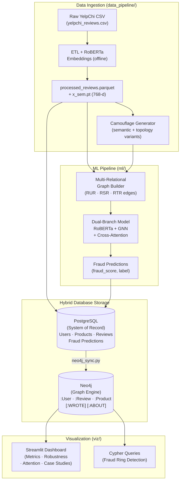
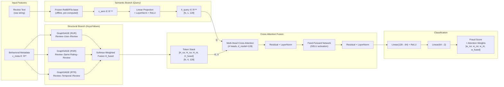
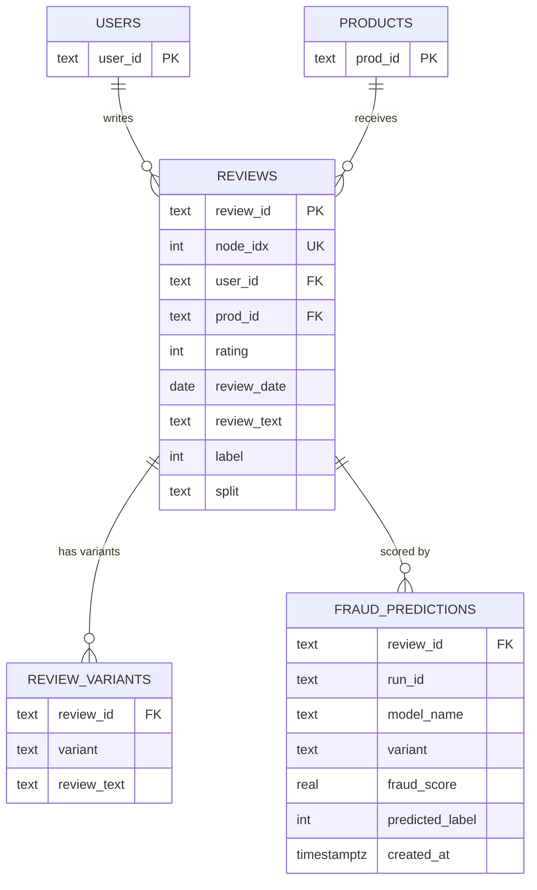
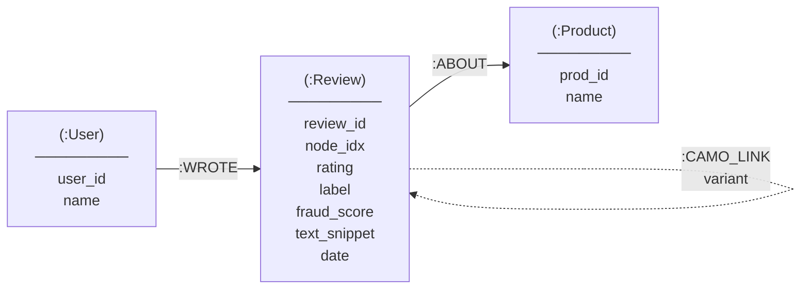
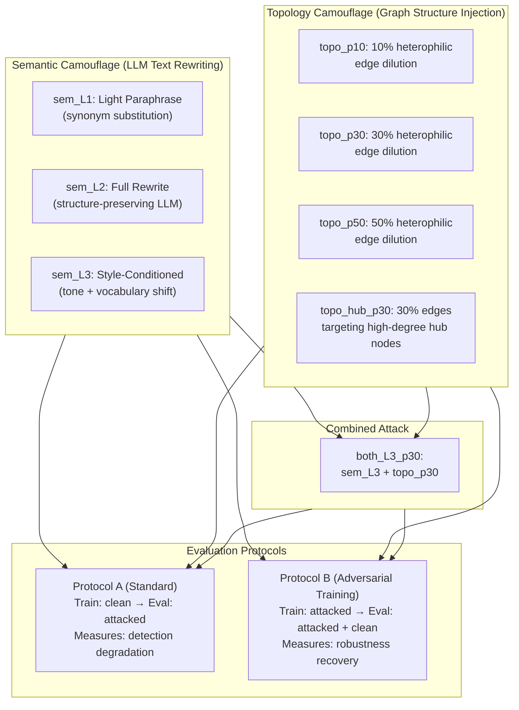
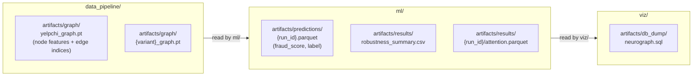

# NeuroGraph-DB

> **A Dual-Branch Graph Transformer with Hybrid RDBMS–Graph Infrastructure for Camouflaged Review Spam Detection**

[](https://www.python.org/)
[](https://pytorch.org/)
[](https://pyg.org/)
[](https://neo4j.com/)
[](https://www.postgresql.org/)
[](LICENSE)

**Course:** Database Systems | **Target Publication:** IEEE ICCDS 2026 (Rajalakshmi Engineering College, Chennai)

---

## Table of Contents

1. [Overview](#overview)
2. [System Architecture](#system-architecture)
3. [ML Model Architecture](#ml-model-architecture)
4. [Database Schema (PostgreSQL)](#database-schema-postgresql)
5. [Graph Schema (Neo4j)](#graph-schema-neo4j)
6. [Camouflage Attack Pipeline](#camouflage-attack-pipeline)
7. [Benchmark Results](#benchmark-results)
8. [Dataset Overview & Statistics](#dataset-overview--statistics)
9. [Project Structure](#project-structure)
10. [Quick Start](#quick-start)
11. [Module Breakdown](#module-breakdown)
12. [Artifact Contracts](#artifact-contracts)
13. [Repository Rules](#repository-rules)

---

## Overview

NeuroGraph-DB is a **relation-aware multimodal fraud-detection framework** that addresses a critical gap in review spam detection: standard GNN-based detectors fail against modern LLM-generated fake reviews that use **"fraud camouflage"** — posting benign-looking reviews across random products to manipulate graph topology and evade detection.

### Key Contributions

| Contribution | Description |
|---|---|
| **Dual-Branch Architecture** | Jointly models frozen RoBERTa (768-d) semantic embeddings and heterogeneous graph topology via Multi-Head Cross-Attention |
| **Hybrid Database** | PostgreSQL as the system of record (ACID, B-tree indexing) + Neo4j as the graph visualization engine (Cypher traversals) |
| **Camouflage Threat Evaluation** | Rigorous evaluation under 9 attack variants: 3 semantic (LLM paraphrase), 4 topology (edge dilution), 1 hub-targeted, 1 combined |
| **Adversarial Training Protocol** | Protocol B demonstrates adversarial training substantially recovers robustness against topology attacks |

---

## System Architecture

The end-to-end pipeline flows from raw YelpChi data ingestion through ML training to graph visualization:



---

## ML Model Architecture

### Dual-Branch Cross-Attention Fusion (NeuroGraph)

The proposed **NeuroGraph** model encodes review text via frozen RoBERTa as the **Query** and uses three heterogeneous GNN branches as **Keys/Values**, fused through Multi-Head Cross-Attention:



### Model Baselines Comparison

| Architecture | Modalities Used | Fusion Strategy |
|---|---|---|
| `text_only` | RoBERTa semantics only | 2-layer MLP |
| `gnn_only` | Behavioral metadata + GNN | Per-relation GraphSAGE + softmax weighted sum |
| `concat` | RoBERTa + GNN | Naive concatenation → MLP |
| `neurograph` (Proposed) | RoBERTa + GNN | Multi-Head Cross-Attention (text as Query) |

---

## Database Schema (PostgreSQL)

The relational schema is normalized to **3NF** with foreign-key integrity and B-tree indexes for analytical query performance.



### B-Tree Indexes

```sql
-- Lookup indexes
CREATE INDEX idx_reviews_user_id    ON reviews(user_id);
CREATE INDEX idx_reviews_prod_id    ON reviews(prod_id);
CREATE INDEX idx_reviews_review_date ON reviews(review_date);
CREATE INDEX idx_reviews_user_prod  ON reviews(user_id, prod_id);  -- composite

-- Analytical indexes
CREATE INDEX idx_reviews_label      ON reviews(label);
CREATE INDEX idx_reviews_split      ON reviews(split);
CREATE INDEX idx_fraud_predictions_score ON fraud_predictions(fraud_score DESC);
```

### Query Performance (SQL vs. Cypher)

| Workload | PostgreSQL (B-tree) | Neo4j (Index-Free Adjacency) | Winner |
|---|---|---|---|
| Point Lookup by Review ID | 0.4 ms | 2.2 ms | **PostgreSQL** |
| Filtered Aggregation (Rating + Date) | 2.1 ms | 8.5 ms | **PostgreSQL** |
| 1-Hop Neighborhood | 3.8 ms | 1.9 ms | **Neo4j** |
| 2-Hop Fraud Ring Traversal | 48.2 ms (nested loop joins) | 3.4 ms | **Neo4j** |
| 3-Hop Collusive Cluster Extraction | 320.5 ms (expensive self-joins) | 6.8 ms | **Neo4j** |

---

## Graph Schema (Neo4j)

The graph is a lightweight projection of the relational data optimized for topological traversals and fraud ring visualization.



### Cypher Queries for Fraud Analysis

```cypher
// 1. Detect multi-hop collusive review rings
MATCH (u1:User)-[:WROTE]->(r1:Review)-[:ABOUT]->(p:Product)<-[:ABOUT]-(r2:Review)<-[:WROTE]-(u2:User)
WHERE u1 <> u2 AND r1.label = 1 AND r2.label = 1
WITH u1, u2, COUNT(DISTINCT p) AS shared_flagged_products
WHERE shared_flagged_products >= 3
RETURN u1.user_id, u2.user_id, shared_flagged_products
ORDER BY shared_flagged_products DESC;

// 2. Identify Camouflage Users via Bimodal Score Variance
// Statistical Justification (YelpChi Empirical Distributions):
// - High-confidence fraud (0.80): Operating threshold corresponding to >90% precision on 15% minority spam class.
// - Low-risk camouflage (0.30): 25th percentile (Q1) of predicted fraud scores for confirmed benign reviews.
// - Minimum reviews (5): Activity threshold to establish statistical significance.
MATCH (u:User)-[:WROTE]->(r:Review)
WITH u,
     count(r) AS total_reviews,
     sum(CASE WHEN r.fraud_score >= 0.80 THEN 1 ELSE 0 END) AS high_score_count,
     sum(CASE WHEN r.fraud_score <= 0.30 THEN 1 ELSE 0 END) AS low_score_count,
     stDev(r.fraud_score) AS score_variance
WHERE total_reviews >= 5
  AND high_score_count >= 1
  AND low_score_count >= 2
  AND (toFloat(low_score_count) / total_reviews) >= 0.40
RETURN u.user_id, total_reviews, high_score_count, low_score_count,
       round(score_variance, 3) AS score_std_dev,
       round(toFloat(low_score_count) / total_reviews, 2) AS camo_ratio
ORDER BY camo_ratio DESC, score_std_dev DESC;
```

---

## Camouflage Attack Pipeline

NeuroGraph-DB evaluates detection robustness against two classes of adversarial attacks:



**Threat Model:**
- **In Scope:** LLM text rewriting (semantic camouflage), injecting cross-links to benign products (topology camouflage)
- **Out of Scope:** Creating new accounts, label flipping, white-box gradient attacks

---

## Benchmark Results

### Clean YelpChi — Protocol A (All models trained on clean data)

| Architecture | ROC-AUC | PR-AUC | F1-Macro |
|---|---|---|---|
| `gnn_only` | 0.9256 ± 0.0023 | 0.7084 ± 0.0130 | 0.7830 ± 0.0056 |
| `concat` | 0.9728 ± 0.0031 | 0.9191 ± 0.0080 | 0.9156 ± 0.0062 |
| `neurograph` (Proposed) | **0.9943 ± 0.0014** | **0.9754 ± 0.0111** | **0.9366 ± 0.0436** |
| `text_only` | 1.0000 ± 0.0000 | 1.0000 ± 0.0000 | 0.9993 ± 0.0012 |

> [!NOTE]
> `text_only` achieves perfect scores on clean data but is vulnerable to semantic camouflage (PR-AUC retention drops to ~82% at `sem_L3`). NeuroGraph maintains **97.7% PR-AUC retention** under topology camouflage.

### Robustness Under Topology Camouflage (Protocol A)

| Model | Clean PR-AUC | `topo_p30` PR-AUC | Retention |
|---|---|---|---|
| `gnn_only` | 0.7084 | 0.3909 | 55.2% |
| `concat` | 0.9191 | 0.6952 | 75.6% |
| `neurograph` (Proposed) | 0.9754 | **0.9525** | **97.7%** |

### Adversarial Training Recovery (Protocol B — `neurograph`)

| Train Variant | Eval Variant | ROC-AUC | PR-AUC |
|---|---|---|---|
| `topo_p30` | `topo_p30` | 0.9999 | 0.9992 |
| `topo_p30` | `clean` | 0.9666 | 0.8325 |
| `both_L3_p30` | `both_L3_p30` | 1.0000 | 0.9999 |

---

## Dataset Overview & Statistics

The benchmark is evaluated on the **YelpChi** spam review dataset (5,000 review academic subgraph), capturing restaurant and hotel reviews in the Chicago area with ground-truth filtered labels assigned by Yelp's production fraud detection algorithm.

### Schema & Column Definitions

| Column | Type | Description | Example |
|---|---|---|---|
| `review_id` | `VARCHAR` | Unique review identifier | `"rev_000000"` |
| `user_id` | `VARCHAR` | Reviewer identity (Foreign Key to users) | `"u_00853"` |
| `prod_id` | `VARCHAR` | Product / Restaurant identity (Foreign Key to products) | `"p_0063"` |
| `rating` | `INTEGER` | Star rating (1 to 5) | `5` |
| `review_date` | `DATE` | Publication date | `"2019-03-14"` |
| `review_text` | `TEXT` | Raw review text content | `"The manager greeted us personally and the dessert menu was phenomenal..."` |
| `label` | `INTEGER` | Ground-truth label (`0` = Benign / Recommended, `1` = Spam / Filtered) | `0` or `1` |
| `node_idx` | `INTEGER` | Graph node index (0 to 4,999) matching PyTorch Geometric tensors | `0` |
| `split` | `VARCHAR` | Data split partition (`train`, `val`, `test`) | `"train"` |

### Sample Records

#### Benign Review Sample (`label = 0`)
```json
{
  "review_id": "rev_000000",
  "user_id": "u_00853",
  "prod_id": "p_0063",
  "rating": 5,
  "review_date": "2019-03-14",
  "review_text": "The manager greeted us personally and the dessert menu was phenomenal. Order confirmed for p_0063.",
  "label": 0,
  "node_idx": 0,
  "split": "train"
}
```

#### Spam / Fraudulent Review Sample (`label = 1`)
```json
{
  "review_id": "rev_000013",
  "user_id": "u_00853",
  "prod_id": "p_0063",
  "rating": 5,
  "review_date": "2021-02-18",
  "review_text": "Greatest deals anywhere in town call 555-1234 for special promotion! Review ID #13 - p_0063.",
  "label": 1,
  "node_idx": 13,
  "split": "train"
}
```

### Dataset Distribution & Multi-Relational Topology

| Metric | Value |
|---|---|
| Total Reviews (Nodes) | 5,000 |
| Benign Reviews (y = 0) | 4,250 (85.0%) |
| Spam Reviews (y = 1) | 750 (15.0%) |
| Unique Users | ~2,000 |
| Unique Products | ~500 |
| Semantic Feature Dim (`x_sem`) | R^768 (frozen RoBERTa-base) |
| Behavioral Feature Dim (`x_meta`) | R^32 (normalized rating, temporal difference, frequency) |

#### Graph Relations (Heterogeneous Edges)

| Relation | Semantics | Avg. Degree | Edge Structure |
|---|---|---|---|
| **R_RUR** | Review–User–Review (written by same reviewer) | 4.2 | Sparse, homophilic |
| **R_RSR** | Review–Same Rating–Review (same product & rating) | 8.6 | Dense review clusters |
| **R_RTR** | Review–Temporal–Review (same product within 30 days) | 5.1 | Temporal review bursts |

#### Split Partitioning

| Split | Node Count | Benign Reviews | Spam Reviews | Spam Ratio |
|---|---|---|---|---|
| Train | 3,000 | 2,550 | 450 | 15.0% |
| Val | 1,000 | 850 | 150 | 15.0% |
| Test | 1,000 | 850 | 150 | 15.0% |

---

## Project Structure

```
NeuroGraph-DB/
│
├── data_pipeline/              # (Owner: Avaneesh)
│   ├── raw/
│   │   ├── yelpchi_reviews.csv         # Source dataset
│   │   ├── processed_reviews.parquet   # ETL output
│   │   ├── x_sem.pt                    # RoBERTa embeddings [N, 768]
│   │   ├── splits.pt                   # Train/Val/Test masks
│   │   └── graph_topology.pt           # Multi-relational edge indices
│   ├── camouflage/             # Camouflage variant generators
│   ├── scripts/
│   │   └── export_db_dump.py           # PostgreSQL → SQL dump utility
│   ├── sql/
│   │   ├── 01_schema.sql               # 3NF table definitions
│   │   └── 02_indexes.sql              # B-tree index definitions
│   ├── docker-compose.postgres.yml
│   ├── Makefile
│   └── STATS.md                        # Dataset statistics
│
├── ml/                         # (Owner: Eldo)
│   ├── models/
│   │   ├── neurograph.py               # Proposed main model (cross-attention)
│   │   ├── gnn_only.py                 # Baseline B1: Relation-aware GNN
│   │   ├── concat_fusion.py            # Baseline B2: Naive concatenation
│   │   └── text_only.py                # Baseline A: Text-only MLP
│   ├── configs/
│   │   ├── default.yaml                # Paper hyperparameters
│   │   ├── neurograph.yaml
│   │   ├── gnn_only.yaml
│   │   ├── concat.yaml
│   │   └── text_only.yaml
│   ├── tests/                          # Pytest test suite
│   ├── figures/                        # Generated robustness + attention plots
│   ├── train.py                        # Training loop (Focal loss, early stopping)
│   ├── evaluate.py                     # Metric computation (AUC, PR-AUC, F1-Macro)
│   ├── robustness.py                   # Protocol A & B evaluation suite
│   ├── ablations.py                    # Architectural ablation studies
│   ├── attention_analysis.py           # Cross-attention distribution analysis
│   ├── data.py                         # Dataset loader + artifact validation
│   ├── mock_data.py                    # Synthetic data generator
│   ├── export_predictions.py           # Export fraud scores to parquet/Postgres
│   └── Makefile
│
├── viz/                        # (Owner: Anubhav)
│   ├── app/
│   │   └── streamlit_app.py            # Interactive Streamlit dashboard
│   ├── sync/
│   │   └── neo4j_sync.py               # PostgreSQL → Neo4j synchronization
│   ├── cypher/
│   │   └── queries.cypher              # Fraud ring detection Cypher queries
│   ├── sql/
│   │   ├── explain_demos.sql           # EXPLAIN ANALYZE before/after indexing
│   │   └── run_explain.py              # SQL performance benchmark runner
│   ├── mock/
│   │   └── seed_mock.py                # Mock data seeder for Neo4j testing
│   ├── tests/
│   │   └── test_sync.py                # Sync pipeline tests
│   ├── docker-compose.neo4j.yml        # Neo4j 5 with APOC plugins
│   └── Makefile
│
├── mock_data/                  # Generated mock CSVs for local testing
│   ├── users.csv
│   ├── products.csv
│   └── reviews.csv
│
├── review_variants/            # Camouflage variant review CSVs
│   └── semantic_1.csv
│
├── artifacts/                  # Cross-module contracts (never commit)
│   ├── graph/                  # PyTorch Geometric graph objects (.pt)
│   ├── predictions/            # Per-run prediction parquets
│   ├── results/                # Metrics JSONs + robustness_summary.csv
│   ├── camouflage/             # Camouflage edge additions per variant
│   └── db_dump/
│       ├── neurograph.sql      # Full PostgreSQL dump (DDL + DML)
│       └── neurograph.sql.gz   # Compressed dump
│
└── docs/
    ├── project_plan.md
    ├── architecture.md
    ├── report_outline.md
    └── references.bib
```

---

## Quick Start

### Prerequisites

- Python 3.10+
- Docker Desktop (for PostgreSQL + Neo4j containers)
- CUDA-capable GPU (optional but recommended for training)

### 1. Clone & Install Dependencies

```bash
git clone <repo-url>
cd NeuroGraph-DB

# Install ML dependencies
pip install -r ml/requirements.txt

# Install viz dependencies (Neo4j + Streamlit)
pip install neo4j pandas streamlit matplotlib seaborn networkx psycopg2-binary
```

### 2. Start Databases

```bash
# Start PostgreSQL
docker compose -f data_pipeline/docker-compose.postgres.yml up -d

# Start Neo4j (access browser at http://localhost:7474)
docker compose -f viz/docker-compose.neo4j.yml up -d
# Credentials: neo4j / neurograph123
```

### 3. Data Pipeline

```bash
# Generate synthetic mock data (no Postgres needed)
python ml/mock_data.py

# OR ingest real YelpChi (requires Postgres running)
cd data_pipeline && make ingest

# Generate RoBERTa embeddings and graph topology
cd data_pipeline && make embed && make graph

# Export DB dump
python data_pipeline/scripts/export_db_dump.py
```

### 4. Train Models

```bash
cd ml

# Train all models on clean YelpChi
make train-all

# Run full robustness benchmark (Protocols A & B)
make robustness

# Run ablation studies
make ablate

# Run attention distribution analysis
make attention
```

### 5. Sync to Neo4j & Launch Dashboard

```bash
# Sync data from Postgres (or parquet fallback) to Neo4j
python viz/sync/neo4j_sync.py

# Sync a specific camouflage variant as a subgraph
python viz/sync/neo4j_sync.py --subgraph --variant camo_1

# Launch Streamlit dashboard
cd viz && make app
# → http://localhost:8501
```

### 6. Run Tests

```bash
# ML tests
cd ml && pytest tests/ -v

# Viz / sync tests
cd viz && pytest tests/ -v
```

---

## Module Breakdown

### `data_pipeline/` — ETL & Camouflage Generation

| Script / File | Purpose |
|---|---|
| `sql/01_schema.sql` | 3NF PostgreSQL schema (users, products, reviews, fraud_predictions) |
| `sql/02_indexes.sql` | B-tree indexes for analytical query performance |
| `scripts/export_db_dump.py` | Exports live DB or builds standalone SQL dump from parquet artifacts |
| `camouflage/` | Generates semantic (LLM rewrite) and topology (edge injection) attack variants |

### `ml/` — Machine Learning Core

| Script / File | Purpose |
|---|---|
| `models/neurograph.py` | Proposed model: RoBERTa Query × GNN Keys/Values → Cross-Attention |
| `models/gnn_only.py` | Relation-Aware GNN with softmax-weighted multi-relational fusion |
| `train.py` | Training loop with Focal loss, AdamW, early stopping on Val PR-AUC |
| `robustness.py` | Protocol A & B evaluation across all 9 attack variants × 5 seeds |
| `ablations.py` | Ablation: remove semantic branch / structural branch / fusion head |
| `attention_analysis.py` | Extracts per-node attention weights [w_rur, w_rsr, w_rtr, w_fused] |
| `export_predictions.py` | Writes fraud scores to `artifacts/predictions/` and PostgreSQL |

### `viz/` — Visualization & Database Integration

| Script / File | Purpose |
|---|---|
| `sync/neo4j_sync.py` | Syncs Users, Products, Reviews, edges to Neo4j in batches of 5,000 |
| `app/streamlit_app.py` | 5-page dashboard: Benchmarks, Robustness, Attention, SQL vs Cypher, Graph Explorer |
| `cypher/queries.cypher` | Ready-to-run Cypher queries for fraud ring and camouflage detection |
| `sql/explain_demos.sql` | EXPLAIN ANALYZE queries demonstrating B-tree index impact |
| `mock/seed_mock.py` | Seeds Neo4j with mock data including planted fraud rings |

---

## Artifact Contracts

Cross-module communication happens **only** through the `artifacts/` directory. Files are never imported directly between modules.



> [!IMPORTANT]
> The `artifacts/` directory is listed in `.gitignore` and must **never** be committed to the repository. Large binary files (`.pt`, `.parquet`) are shared via local storage or artifact registries only.

### Graph Artifact Schema (validated by `ml/data.py`)

```python
graph = torch.load("artifacts/graph/yelpchi_graph.pt")
# Required keys:
# graph.x_sem:          [N, 768]   float32  — RoBERTa embeddings
# graph.x_meta:         [N, 32]    float32  — behavioral metadata
# graph.y:              [N]        long     — labels (0=benign, 1=spam)
# graph.edge_index_rur: [2, E_rur] long     — Review-User-Review edges
# graph.edge_index_rsr: [2, E_rsr] long     — Review-Same Rating-Review edges
# graph.edge_index_rtr: [2, E_rtr] long     — Review-Temporal-Review edges
# graph.train_mask:     [N]        bool
# graph.val_mask:       [N]        bool
# graph.test_mask:      [N]        bool
```

---

## Repository Rules

> [!WARNING]
> Violating these rules will cause merge conflicts and break the cross-module artifact contract.

| Rule | Details |
|---|---|
| **Folder ownership** | Only edit your own folder. `data_pipeline/` → Avaneesh · `ml/` → Eldo · `viz/` + `docs/` → Anubhav |
| **No `artifacts/` commits** | Never commit `artifacts/`. Use `.gitignore` to exclude it. |
| **Branch naming** | `<name>/<feature>` (e.g., `eldo/cross-attention-v2`) |
| **Rebase before push** | Always run `git pull --rebase origin main` before every push |
| **PRs touch only your folder** | Pull requests must not modify files outside your owned directory |
| **Handoff via artifacts** | Cross-folder data exchange only through `artifacts/` contracts |

---

## Model Hyperparameters

| Hyperparameter | Value | Rationale |
|---|---|---|
| `d_model` | 128 | Balanced capacity vs. compute for 5K node graph |
| `num_heads` | 4 | 4 × 32-d attention heads covering 4 KV tokens |
| `dropout` | 0.2 | Regularization on imbalanced (85:15) dataset |
| `optimizer` | AdamW | Weight decay for generalization |
| `lr` | 1e-3 | Converges within 60 epochs with early stopping |
| `loss` | Focal (γ=2.0, α=0.75) | Handles 85:15 class imbalance |
| `patience` | 15 | Early stopping monitors Val PR-AUC |
| `seeds` | [42, 43, 44] | 3-seed mean ± std for reproducibility |

---

## Citation

```bibtex
@article{neurograph2026,
  title   = {NeuroGraph-DB: A Dual-Branch Graph Transformer with Hybrid RDBMS–Graph
             Infrastructure for Camouflaged Review Spam Detection},
  author  = {Avaneesh and Eldo and Anubhav},
  journal = {IEEE ICCDS 2026},
  year    = {2026},
  address = {Rajalakshmi Engineering College, Chennai}
}
```

---

*Built with PyTorch Geometric · RoBERTa · PostgreSQL · Neo4j · Streamlit*
