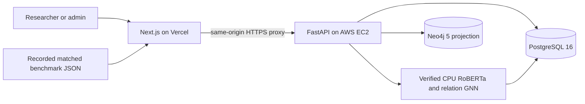

# System architecture

NeuroGraph-DB provides authenticated review analysis, private saved upload history, graph investigation and human feedback. The current schema has 23 domain tables and Alembic head `0007_database_features`.

## Application data flow

The frontend submits a six-column CSV to FastAPI. The API validates rows, resolves source identities, stores receipts and starts a durable inference job. The current processing endpoint invokes the worker function synchronously; the database retains job leases, run identity and failures. This is not an autonomous worker service or automatic retraining pipeline.

Scoring verifies model artifacts, loads permitted training-partition history without selecting labels, limits history to the batch's arrival cutoff, and builds RUR/RSR/RTR links from earlier reviews. Earlier rows in that upload may supply context for later rows. The selected snapshot remains unchanged. Scores, thresholds, attention, neighbors and evidence fingerprints are saved in PostgreSQL.

The API prefixes uploaded source namespaces with the authenticated user ID, keeping imported reviews/authors/products separate across users even for identical filenames and external IDs. Old saved receipts are still readable and retries can recover the original requester's receipt. Ordinary uploaded identities do not join to Yelp reference identities: their effective relational context and activity counts are within-file. The snapshot remains an eligibility/compatibility requirement, not a source of unrelated business history. Both snapshot scope and relation schema must match the model policy; either mismatch blocks scoring.

For a completed result, `batch_analysis_graph.py` reconstructs the inference connections, checks their saved fingerprint, and writes the relevant `UploadAnalysisReview` nodes and `CONTEXT_FOR` links to Neo4j. The graph projection supports inspection; PyTorch/PyG calculate the neural scores. Synthetic examples have a separate projection.

## Ownership and access

Researchers see their own uploaded analyses and feedback. Admins can explicitly inspect all-user history, create/list accounts, moderate feedback and control snapshot context permission. Server-side checks protect privileged mutations and private analyses. Reviewer catalog is an authenticated source-author directory; its placement under the admin sidebar is not an ADMIN-only API boundary. User creation/listing is implemented; arbitrary account deletion or password reset is not claimed.

Argon2 protects stored passwords. Short-lived JWT access tokens and rotating HttpOnly refresh cookies manage sessions. CORS accepts configured origins. Credentials, private data exports and model bundles remain outside Git and browser configuration.

## Database features

PostgreSQL is the authoritative record store. SQLAlchemy models and Alembic manage keys, constraints, indexes and transactions. Migration 0007 adds two aggregate views, `resolve_review_feedback` and the feedback audit trigger. Human feedback never overwrites the historical model score or silently retrains the model.

The Audit operations page shows diagnostics. Stored `audit_logs` records are not currently exposed through a complete audit-log viewer. The generic readiness endpoint retains a legacy inference check; verified model-specific status and successful inference establish availability of the deployed model path.

## Model evaluation and publication

`ml/benchmark_matched.py` compares text-only, graph-only, concatenation and the deployed NeuroGraph architecture using one fixed temporal split and three training seeds. `scripts/publish_benchmark.py` verifies run manifests before exporting the recorded report to documentation and the frontend. The Model comparison page renders measured metrics and curves; it does not train models in the browser. Historical runs are displayed separately without a combined ranking.

Temporal replay can use earlier unlabelled arrivals as context. A live upload's permitted snapshot and batch may supply different history. Benchmark scores are not a measured accuracy claim for every uploaded file.

## Hosting

Vercel Hobby serves Next.js. Docker Compose on one AWS EC2 instance runs FastAPI, PostgreSQL 16, Neo4j 5 and Caddy HTTPS. CloudFormation describes infrastructure; SSM provides terminal management. Private S3 bundles are outside Git and the Docker image. AWS hosting consumes finite Free-plan credits. CI tests/builds the project; terminal scripts deploy it. Render and the earlier Express/Prisma backend are not part of this deployment.
