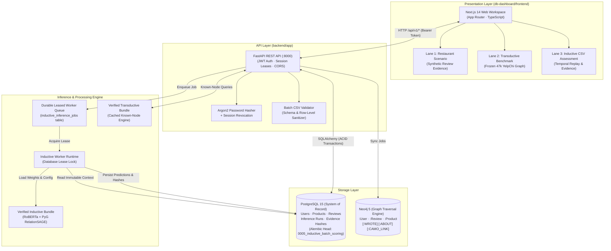
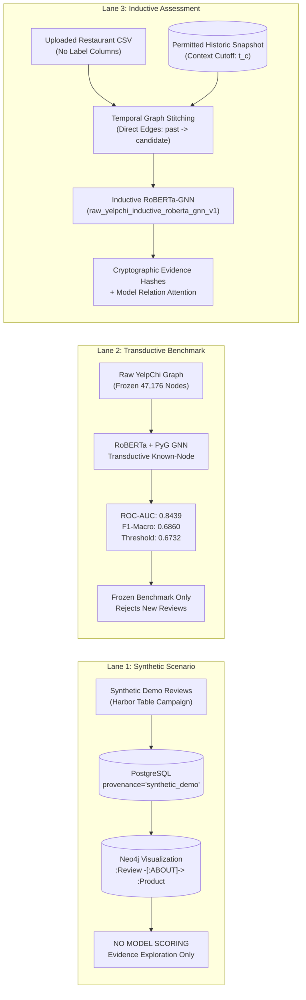

# NeuroGraph-DB System Architecture

This document provides the formal architectural specification for NeuroGraph-DB, detailing system components, relational schemas, graph projection, role-based access control, fail-closed ML model loading, and the three-lane provenance separation model.

---

## 1. System Overview & Component Stack

NeuroGraph-DB combines a high-throughput relational database (PostgreSQL), an index-free adjacency graph engine (Neo4j), a modern web application (Next.js 14), and a verified PyTorch Geometric / RoBERTa deep learning inference engine (FastAPI + Celery/SQL-backed durable leased worker queue).

### Component Breakdown

1. **Frontend (Next.js 14 App Router):**
   - Implemented in `db-dashboard/frontend/` using TypeScript, Tailwind CSS, and Lucide React monochromatic icons.
   - Operates with strict separation across three operational lanes: Restaurant Scenario Evidence, Verified Transductive Benchmark, and Inductive Restaurant CSV Assessment.
   - Features real-time state polling, cryptographic evidence inspection modals, and deterministic risk tier visualizations.
2. **Backend API (FastAPI):**
   - Implemented in `backend/app/`, exposing authenticated REST endpoints under `/api/v1/`.
   - Security layer leverages Argon2id for password hashing, cryptographically random session tokens stored in PostgreSQL, and role-based route dependencies (`require_roles`).
   - Transactional audit log captures every state-changing operational action (`AuditLog` table).
3. **Relational Database (PostgreSQL 15):**
   - The authoritative system of record normalized to 3NF.
   - Enforces relational foreign-key integrity, non-null constraints, and B-tree indexing across review dates, authors, products, and risk scores.
   - Schema versioning controlled via Alembic, currently migrated to head `0005_inductive_batch_scoring`.
4. **Graph Database (Neo4j 5):**
   - Optimized for multi-hop neighborhood traversals, collusive review ring detection, and bimodal camouflage score variance analysis.
   - Serves as a read-optimized topological projection of the relational records.
5. **Durable Leased Worker Queue:**
   - Managed via the `inductive_inference_jobs` table linked one-to-one with `inference_runs`.
   - Workers claim jobs using pessimistic database row leases (`status = 'leased'`, `lease_expires_at = NOW() + TTL`).
   - Guaranteed at-least-once execution with deterministic retry counts (`attempt_count <= max_attempts`) and dead-letter failure logging (`last_error_code`, `last_error`).
6. **Verified Model Runtimes:**
   - Bundles loaded under fail-closed verification routines that check file hashes, Hugging Face tokenizer revisions, and local fixed-node score reproduction before accepting inference requests.

---

## 2. Role-Based Access Control (RBAC)

The system defines two primary roles within the `roles` table (`ADMIN` and `RESEARCHER`):

| Capability / Resource | Administrator (`ADMIN`) | Researcher (`RESEARCHER`) | Enforcement Point |
| :--- | :---: | :---: | :--- |
| **User Administration** | Create, view, deactivate users | Read-only access to own profile | `require_roles("ADMIN")` on `/api/v1/users` |
| **Audit Log Inspection** | Full access to system audit trail | Ineligible | `require_roles("ADMIN")` on audit endpoints |
| **Graph Snapshot Permission** | Grant/revoke `batch_context_permitted` | Ineligible (read-only snapshot inspection) | `require_roles("ADMIN")` on `/graph-snapshots/{id}/batch-context-permission` |
| **Graph Sync Jobs** | Enqueue snapshot rebuilds & sync jobs | Ineligible | `require_roles("ADMIN")` on `/api/v1/graph-sync-jobs` |
| **Batch Analysis Upload** | Allowed for any batch | Allowed for own researcher account | `current_user` dependency on `/api/v1/batch-analyses` |
| **Batch Results Inspection** | Can view any user's batch | Can only inspect batches created by own user | `_assert_can_read_batch` row ownership check |
| **Trigger Batch Scoring** | Allowed across all valid batches | Allowed on own queued batches | `_assert_can_read_batch` row ownership check |
| **Model Registry & Status** | View all models, statuses, and hashes | View all models, statuses, and hashes | Authenticated user (`current_user`) |
| **Verified Baseline Exploration** | Read-only benchmark inspection | Read-only benchmark inspection | Authenticated user (`current_user`) |

---

## 3. Provenance & Fail-Closed Model Loading

NeuroGraph-DB maintains strict provenance isolation between synthetic test demonstrations and real benchmark machine learning inference.

### Provenance Flags
- `synthetic_demo`: Synthetic attack scenario data (e.g., Harbor Table review-bombing). Data bearing this tag cannot be scored by real verified ML models.
- `real`: Authenticated benchmark datasets and real restaurant review uploads. Only `real` records can interact with verified neural networks.

### Fail-Closed Verification Protocol

Before any model checkpoint is permitted to score reviews, the runtime executes a multi-stage integrity check (`_verify()`):

1. **Manifest Existence & Hash Matching:**
   - The bundle must contain `run_manifest.json`.
   - The computed SHA-256 of `run_manifest.json` must exactly match the committed run record in Git (`docs/runs/`).
2. **File Checksum Validation:**
   - Every constituent file listed in the manifest (`model_state.pt`, `serving_graph.pt`, `model_config.json`, `preprocessing.json`, `evaluation_targets.npz`) must exist on disk.
   - Each file's SHA-256 must match the manifest entry bit-for-bit.
3. **Tokenizer Revision Pinning:**
   - The Hugging Face RoBERTa tokenizer must resolve to the exact pinned revision:
     `e2da8e2f811d1448a5b465c236feacd80ffbac7b`.
   - Any attempt to pull dynamic `HEAD` weights triggers an immediate runtime abort.
4. **Fixed-Node Cryptographic Invariant:**
   - The runtime extracts a designated fixed review from the manifest.
   - It performs forward inference on the node and verifies that the predicted score matches `expected_fraud_score` within an absolute numerical tolerance of $\le 10^{-6}$.
   - It verifies that no ground-truth labels were accessed or required during reproduction (`labels_required_for_reproduction == False`).
5. **Snapshot Scope Enforcement:**
   - For inductive batch scoring, the selected historical graph snapshot must have `batch_context_permitted == True` and its `context_scope_key` must match the model's relation policy (`inductive-rur-rsr-rtr-v1`).
   - Incompatible snapshots are rejected with HTTP 409 `snapshot_scope_incompatible`.
6. **Anti-Fabrication Guarantee:**
   - If any verification check fails, the runtime raises `BundleVerificationError` (HTTP 503 `bundle_verification_failed`).
   - The system preserves a failed `inference_run` record with a stable failure code and writes **zero** fabricated predictions or simulated graph links.

---

## 4. The Three-Lane Architecture

To eliminate confusion between synthetic mock scenarios, published research benchmarks, and real-time inference, the system categorizes all operations into three distinct lanes:

### Lane 1: Synthetic Restaurant Scenario Evidence
- **Target Dataset:** Synthetic campaign `harbor-table-review-bombing-seed-42` (100 synthetic reviews targeting product `p_0063`).
- **Data Provenance:** Tagged `synthetic_demo` across PostgreSQL and Neo4j.
- **Operational Boundary:** Used exclusively for UI exploration, PostgreSQL B-tree index benchmarking, and Neo4j Cypher graph visualization (e.g., detecting collusive rings and bimodal rating attacks).
- **ML Scoring Rule:** **No ML fraud scores are generated.** Synthetic reviews are barred from model evaluation to prevent unverified model outputs from being misrepresented as real predictions.

### Lane 2: Verified Transductive Benchmark
- **Target Dataset:** The 47,176-review raw YelpChi homogeneous multi-relational graph constructed from `training_data.csv` (`samygithub/collective-opinion-spam-detection`).
- **Model Architecture:** `raw_yelpchi_multimodal_roberta_pyg_gnn` featuring frozen 768-d RoBERTa embeddings, 14 label-free numerical features, and relation-specific PyG GraphSAGE layers with text-conditioned cross-attention.
- **Verified Benchmark Metrics:**
  - Test ROC-AUC: `0.8439` (0.843882)
  - Test F1-Macro: `0.6860` (0.685993)
  - Test PR-AUC: `0.4507` (0.450667)
  - Decision Threshold: `0.673232`
- **Fixed Node Verification:** Review `--AweNX8vPGD` (node index 2) reproduces score `0.00680473` within $1\times 10^{-6}$.
- **Operational Boundary:** Transductive known-node serving only. Predictions are precomputed and cached in-memory on startup. Any attempt to query review IDs outside the frozen 47,176-node snapshot is rejected with HTTP 404 `not part of verified graph snapshot`.

### Lane 3: Inductive Restaurant CSV Assessment
- **Target Dataset:** User-uploaded restaurant CSV batches evaluated against an immutable, permitted historical context graph snapshot.
- **Model Family:** `raw_yelpchi_inductive_roberta_gnn_v1`.
- **Relational Policy (`inductive-rur-rsr-rtr-v1`):**
  - Directed strictly from past historic reviews to candidate uploaded reviews ($src < tgt$ and $date[src] \le date[tgt]$).
  - Enforces deterministic ordering and a cap of 50 neighbors per relation (RUR: same author, RSR: same restaurant & rating, RTR: same restaurant within 30 days).
  - Zero leakage: Candidate reviews cannot form edges to future reviews or mutate the immutable historical snapshot.
- **Validation-Derived Decision Threshold:** `0.787071` (selected on chronological validation window arrivals; test split evaluated exactly once).
- **Verified Benchmark Metrics:**
  - Test ROC-AUC: `0.8105` (0.810486)
  - Test F1-Macro: `0.6624` (0.662444)
  - Test PR-AUC: `0.4211` (0.421073)
- **Fixed Node Verification:** Review `PmQBUjV1wPZxWFWXb7S5lg` (node index 37,740) reproduces score `0.00159266` within $2.33\times 10^{-10}$.
- **Audit & Evidence Persistence:**
  - For each scored review, persists actual relation-attention weights emitted by the neural network (`w_rur`, `w_rsr`, `w_rtr`).
  - Persists an immutable `inductive_prediction_evidence` record linking the prediction to the snapshot ID, context cutoff timestamp, neighbor counts, connected historic review IDs, stitched graph SHA-256, input feature SHA-256, embedding SHA-256, and bundle manifest SHA-256.
