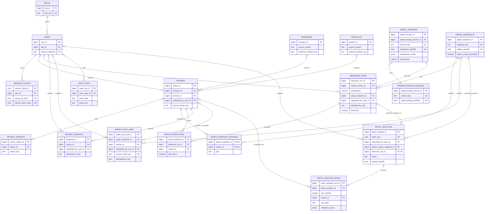

# NeuroGraph-DB Relational ERD

**Status:** Approved Phase 2 relational design with the Phase 5 batch-analysis extension. The roadmap's 12 entities are retained, with six supporting entities: `graph_snapshots`, `graph_snapshot_reviews`, `preprocessing_versions`, `session_tokens`, `batch_analyses`, and `batch_analysis_rows`. Together, the design contains 18 tables. The batch extension is implemented by Alembic revision `0002_batch_analyses`.

## Design boundaries

- PostgreSQL is the system of record. Neo4j is a projection managed by durable `graph_sync_jobs`.
- Login identities (`users`) are separate from review authors (`reviewers`).
- A `model_versions` row references one immutable `preprocessing_versions` record and one checkpoint/config identity. This removes the transitive dependency from a preprocessing version label to its checksum in the model table.
- A `graph_snapshots` row describes an immutable graph artifact. `graph_snapshot_reviews` is the authoritative membership mapping and stores each review's split within that snapshot.
- An `inference_runs` row pins a model version, graph snapshot, and exact threshold. Its predictions must refer to reviews in that snapshot; the service/procedure validates membership. A prediction's provenance is available through `fraud_predictions -> inference_runs -> model_versions -> preprocessing_versions` and `inference_runs -> graph_snapshots`.
- The Phase 1 audit found no compatible checkpoint and showed current repository graph artifacts are synthetic. The schema does not claim a verified model, calibrated score, or unseen-review inference.
- Internal primary keys use PostgreSQL `BIGINT GENERATED ... AS IDENTITY`, except opaque UUID keys for sessions/public run IDs. Source identifiers remain strings scoped by source system.

## Entity relationship diagram

Mermaid cardinalities: `o|` zero-or-one; `||` exactly one; `o{` zero-or-many. One user has one role in this design. If multiple roles per user become a confirmed requirement, add a `user_roles` bridge in a separate reviewed schema change.

## Keys and uniqueness

- `roles.role_key` unique and immutable.
- `users.email_normalized` unique; optional normalized username unique when present.
- `session_tokens.access_jti_hash` and `refresh_token_hash` unique. Store only hashes, never bearer/refresh token plaintext.
- `reviewers`: unique `(source_system, external_reviewer_key)`; `products`: unique `(source_system, external_product_key)`.
- `reviews`: `source_system` and `source_review_key` are both null or both set. When set, unique `(source_system, source_review_key)`.
- `review_variants`: unique `(review_id, variant_key)`.
- `preprocessing_versions.version_key` and `preprocessing_sha256` unique.
- `model_versions.version_key` and non-null `checkpoint_sha256` unique. Preprocessing identity is a non-null FK, not duplicated text/hash columns.
- `model_versions.provenance` is restricted to `real` or `synthetic_demo`; synthetic demo models cannot have lifecycle `verified`. Unique `(model_version_id, provenance)` supports a composite FK from inference runs.
- `inference_runs.provenance` must match its referenced model's provenance through `fk_run_model_prov`.
- `graph_snapshots.snapshot_key` and `artifact_sha256` unique.
- `graph_snapshot_reviews`: composite PK `(graph_snapshot_id, review_id)`; a review belongs to at most one split within a given snapshot. Split is an attribute of this membership.
- `inference_runs`: `run_key` unique; user-scoped unique `(requested_by_user_id, idempotency_key)` when key is present. A non-null key requires non-null user ID. Background runs may omit both.
- `fraud_predictions`: unique `(inference_run_id, review_id)`.
- `review_feedback`: user-scoped unique `(submitted_by_user_id, idempotency_key)` when key is present; a non-null key requires non-null user ID.
- `graph_sync_jobs`: `source_event_key` is globally unique for internal/outbox deduplication. API idempotency uses user-scoped unique `(requested_by_user_id, idempotency_key)`; a non-null key requires a user ID. These are distinct key purposes.

## Foreign keys and deletion

| Relationship | Delete behavior | Rationale |
|---|---|---|
| `users.role_id -> roles` | `RESTRICT` | Preserve valid authorization; deactivate users instead of deleting. |
| `session_tokens.user_id -> users` | `CASCADE` | Removing an account removes all sessions; deactivation separately revokes active sessions. |
| `reviews.reviewer_id -> reviewers` | `SET NULL` | Keep review if author identity is removed/unknown. |
| `reviews.product_id -> products` | `SET NULL` | Keep review when product identity is removed. |
| `reviews.submitted_by_user_id -> users` | `SET NULL` | Preserve review history if app account is removed. |
| `review_variants.review_id -> reviews` | `CASCADE` | Variant has no meaning without its review. |
| `model_versions.preprocessing_version_id -> preprocessing_versions` | `RESTRICT` | Preserve immutable preprocessing provenance. |
| `inference_runs.model_version_id -> model_versions` | `RESTRICT` | Retire model versions instead of deleting referenced lineage. |
| `inference_runs.graph_snapshot_id -> graph_snapshots` | `RESTRICT` | Snapshot must remain identifiable for reproducibility. |
| `inference_runs.requested_by_user_id -> users` | `SET NULL` | Keep run history if actor is deleted. |
| `graph_snapshot_reviews.graph_snapshot_id -> graph_snapshots` | `CASCADE` | Membership rows have no meaning without their snapshot. |
| `graph_snapshot_reviews.review_id -> reviews` | `RESTRICT` | Prevent removing a review represented in retained snapshots. Use de-identification/retention policy. |
| `fraud_predictions.inference_run_id -> inference_runs` | `RESTRICT` | Retain prediction provenance. |
| `fraud_predictions.review_id -> reviews` | `RESTRICT` | Retain scored subject. |
| `review_feedback.review_id -> reviews` | `RESTRICT` | Preserve feedback context. |
| `review_feedback.submitted_by_user_id -> users` | `SET NULL` | Preserve feedback after account removal. |
| `graph_sync_jobs.graph_snapshot_id -> graph_snapshots` | `RESTRICT` for rebuild jobs | Keep snapshot sync provenance. |
| `graph_sync_jobs.review_id -> reviews` | `RESTRICT` | A review-scoped job's required scope must remain identifiable; resolve or archive the job before review erasure. |
| `graph_sync_jobs.requested_by_user_id -> users` | `SET NULL` | Preserve job after requesting account removal. |
| `audit_logs.actor_user_id -> users` | `SET NULL` | Audit events outlive login accounts. Audit rows are append-only. |

Primary and foreign keys are immutable. Do not routinely cascade-delete prediction or audit history. Retention and legal erasure require an explicit privileged workflow.

Before privileged hard deletion of a user who owns an inference, feedback, or sync request idempotency key, the same transaction must null the relevant actor FK and `idempotency_key` in retained history. This preserves the CHECK that a key has an owner while retaining the run/feedback/job. Normal operation deactivates the account and revokes its sessions instead.

## 3NF rationale

- **1NF:** entities and multi-valued relationships are represented as rows. `graph_snapshot_reviews` resolves the many-to-many snapshot/review membership and carries the split for that membership. JSONB is restricted to versioned configuration or redacted audit snapshots.
- **2NF:** single-column surrogate keys are used except `graph_snapshot_reviews`' composite key. Its `split` depends on the complete `(graph_snapshot_id, review_id)` membership key.
- **3NF:** source reviewer/product facts, preprocessing facts, model/checkpoint facts, graph snapshot facts, snapshot membership/split facts, run facts, and prediction facts each live in their own relations. `preprocessing_version_id` points to the row that owns its checksum; the checksum is not repeated in `model_versions`. User-scoped idempotency is unique on its full determinant. `fraud_predictions` reaches threshold/checkpoint/preprocessing/snapshot through its run rather than copying those values.
- `audit_logs.entity_type/entity_key` is intentionally polymorphic and cannot have a conventional FK to every entity; triggers/services validate source events.

## Integrity rules and operational support

Detailed columns, checks, and indexes are in [DATA_DICTIONARY.md](DATA_DICTIONARY.md). Important cross-row rules (only verified models may run; every prediction review is a member of the run's graph snapshot; label agrees with the run threshold) require a transaction/service check or trigger/procedure because ordinary row `CHECK`s cannot reference other tables.

- **CRUD, joins, aggregates:** CRUD lifecycle by entity is described in the dictionary. Join reviews to authors/products; predictions through run, model, preprocessing, graph, and snapshot membership; aggregate only within a run/model/snapshot to avoid mixing incompatible outputs.
- **Views:** `vw_high_risk_reviews` exposes flagged predictions with run provenance. `vw_product_risk_summary` groups by product and inference run. “High risk” means the stored prediction label at that run's threshold, not confirmed fraud.
- **Transactions:** insert an inference run and work request atomically; persist prediction batches idempotently and finalize status atomically. Feedback and its audit event commit together. SQLAlchemy `Session.begin()` scopes transactions.
- **Stored procedure:** a narrow `finalize_inference_run(run_id)` may validate expected prediction count and snapshot membership, then mark the run complete. It does not implement inference.
- **Trigger/audit:** selected mutations append redacted, allowlisted before/after fields to `audit_logs`; exclude password/token hashes and raw review text. The application role cannot update/delete audit rows.
- **ORM:** SQLAlchemy 2.x models follow these FKs and constraints; use bound `select`, explicit joins, bounded eager loading, and database views for stable aggregates. Alembic owns views, triggers, procedures, and schema evolution.
- **Backup/restore:** encrypted PostgreSQL custom-format backups use `pg_dump -Fc`/`pg_restore`, record schema revision and checksums, and are restore-tested. Checkpoint and graph artifacts require separate versioned backup/checksum coverage. Neo4j is reconciled/rebuilt from PostgreSQL records, snapshot membership, and a pinned graph definition.

