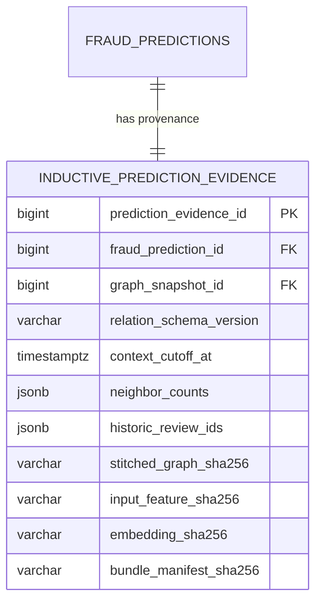

# NeuroGraph-DB Inductive Temporal Evaluation Protocol

This document details the engineering specifications, anti-leakage invariants, edge construction policies, and durable worker lifecycle governing **Lane 3 (Inductive Restaurant CSV Assessment)** in NeuroGraph-DB.

---

## 1. Protocol Overview & Motivation

Traditional graph neural network benchmarks for fraud detection (such as legacy YelpChi) operate transductively: the entire graph topology — including validation and test nodes — is visible during message passing. In real-world fraud operations, this transductive setup is invalid because:
1. Future reviews do not exist when a candidate review is submitted.
2. Global reviewer activity counts and mean product ratings cannot anticipate future submissions.
3. Test nodes cannot participate in message-passing neighborhoods of historical nodes.

NeuroGraph-DB addresses this fundamental problem through the **Honest Inductive Replay Protocol** (`inductive_temporal_replay`) implemented by the `raw_yelpchi_inductive_roberta_gnn_v1` model family.

---

## 2. Ingestion & Validation Contract

### CSV Schema Requirements
Uploaded review CSV files must supply the following exact headers:
```csv
review_id,reviewer_id,product_id,rating,review_date,review_text
```

### Validation Rules
- **No Ground-Truth Labels:** Columns such as `label`, `Label`, or `ground_truth_label` are **never** required and are omitted in restaurant uploads.
- **Row-Level Parsing:**
  - `review_id`: Non-empty string (1–160 chars).
  - `reviewer_id`: Non-empty alphanumeric external user identifier.
  - `product_id`: Non-empty alphanumeric external product / restaurant identifier.
  - `rating`: Numeric rating strictly within the $[1, 5]$ star interval.
  - `review_date`: Valid ISO 8601 calendar date or timestamp (e.g., `YYYY-MM-DD` or `YYYY-MM-DDTHH:MM:SSZ`).
  - `review_text`: Non-empty review text string.
- **Transactional Ingestion:** If a row violates the schema, its specific row error is recorded in `batch_analysis_rows.validation_errors`. Valid rows are accepted and persisted; invalid rows are flagged without blocking accepted rows.

---

## 3. Chronological Arrival Windows

The benchmark partitions the 47,176-review raw YelpChi dataset by chronological arrival order $(t_{\text{date}}, \text{review\_id})$:

```
2004-10-23                                2011-02-06                      2011-11-15                 2012-10-08
├─── TRAIN SPLIT (60%, N=28,305) ──────────┼─── VAL SPLIT (20%, N=9,435) ──┼─── TEST SPLIT (20%, N=9,436) ──┤
│    Nodes 0 to 28,304                     │    Nodes 28,305 to 37,739     │    Nodes 37,740 to 47,175      │
│    Spam Ratio: 13.15%                    │    Spam Ratio: 13.46%         │    Spam Ratio: 13.26%          │
└──────────────────────────────────────────┴───────────────────────────────┴────────────────────────────────┘
```

### Temporal Anti-Leakage Invariants
1. **Streaming Arrival Identity:** Validation and test reviews are evaluated strictly as new arrivals at timestamp $t$.
2. **Train-Only Scaler Fitting:**
   - Numerical behavioral feature scalers (`StandardScaler`) are fit **exclusively** on training arrival nodes ($N=28,305$).
   - Validation and test features are normalized using the frozen training scaler parameters.
3. **Validation-Only Operating Threshold:**
   - The decision threshold ($0.787071$) is selected by maximizing the macro-averaged F1 score on validation window arrivals.
   - The test split is scored **exactly once** using this frozen threshold. Test labels are never observed during threshold calibration.

---

## 4. Relational Edge Policy (`inductive-rur-rsr-rtr-v1`)

During inference, edges are constructed dynamically between candidate reviews and an immutable historical graph context.

### Directionality & Causality
All edges are strictly directed from past reviews to the candidate review:
$$\text{src} \prec \text{tgt} \iff \text{date}[\text{src}] \le \text{date}[\text{tgt}] \quad \text{and} \quad \text{node\_idx}[\text{src}] < \text{node\_idx}[\text{tgt}]$$
- Zero edges flow from future reviews to past reviews.
- Zero edges flow from candidate reviews back into the historical context.

### Multi-Relational Definitions

| Relation | Semantic Meaning | Matching Predicate | Temporal Constraint |
| :--- | :--- | :--- | :--- |
| **RUR** | Review–User–Review | $\text{reviewer\_id}[\text{src}] == \text{reviewer\_id}[\text{tgt}]$ | $\text{date}[\text{src}] \le \text{date}[\text{tgt}]$ |
| **RSR** | Review–Same Rating–Review | $\text{product\_id}[\text{src}] == \text{product\_id}[\text{tgt}] \land \text{rating}[\text{src}] == \text{rating}[\text{tgt}]$ | $\text{date}[\text{src}] \le \text{date}[\text{tgt}]$ |
| **RTR** | Review–Temporal–Review | $\text{product\_id}[\text{src}] == \text{product\_id}[\text{tgt}]$ | $0 \le \text{date}[\text{tgt}] - \text{date}[\text{src}] \le 30\text{ days}$ |

### Deterministic 50-Neighbor Cap & Tie-Breaking
To prevent hub explosion and ensure reproducible graph stitching across worker nodes:
- Each candidate node accepts at most **50 neighbors per relation**.
- Candidate neighbors are sorted using deterministic tie-breakers:
  - **RUR & RSR:** Sorted by `(-src_date, src_review_id)` (most recent historic reviews prioritized).
  - **RTR:** Sorted by `(abs(date_diff), src_review_id)` (closest temporal reviews prioritized).
- In the event of identical dates, lexicographical comparison on `review_id` guarantees bit-identical neighborhood construction.

### Snapshot Immutability Guarantee
The historical graph context stored in PostgreSQL (`graph_snapshots`) and on disk (`serving_graph.pt`) is strictly read-only. Inductive inference constructs transient stitched graph structures in-memory; no edges or nodes are appended to the frozen historical baseline.

---

## 5. Label-Free Context Ingestion

To prevent target leakage during live inference:
- The context query executed by `load_permitted_historic_context` queries only non-label attributes:
  ```sql
  SELECT review_id, reviewer_id, product_id, rating, review_date, review_text
  FROM reviews
  WHERE review_id IN (...)
  ```
- The fields `ground_truth_label` and `label_source` are excluded from the SQL projection.
- If a snapshot's `batch_context_permitted` flag is `false` or its `context_scope_key` does not match `inductive-rur-rsr-rtr-v1`, the upload is rejected immediately with HTTP 409 `snapshot_scope_incompatible`.

---

## 6. Durable Worker Queue Lifecycle

Batch inference executes asynchronously using a leased worker model backed by the `inductive_inference_jobs` table:

```mermaid
stateDiagram-v2
    [*] --> Queued: Batch uploaded with permitted snapshot
    Queued --> Leased: Worker acquires lease (NOW() + TTL)
    Leased --> Succeeded: Inference complete & evidence persisted
    Leased --> Failed: Verification failure or fatal error
    Leased --> Queued: Lease expired (attempt_count < max_attempts)
    Failed --> [*]: Preserved failure code; 0 fake predictions
    Succeeded --> [*]: Batch analysis marked completed
```



### Worker State Invariants
1. **Pessimistic Lease Locking:** A worker process claims a pending job using atomic database updates:
   ```sql
   UPDATE inductive_inference_jobs
   SET status = 'leased', worker_id = :worker_id,
       lease_expires_at = NOW() + INTERVAL '300 seconds',
       attempt_count = attempt_count + 1
   WHERE job_id = :job_id AND status = 'queued';
   ```
2. **Idempotency & Deduplication:** Uploads providing an `Idempotency-Key` header reuse existing inference runs and return the queued job without duplicating background workloads.
3. **Dead-Letter Logging:** If execution encounters unrecoverable errors (e.g., manifest corruption, missing files), the job transitions to `failed`, recording `last_error_code` and `last_error`. The corresponding `inference_run` is marked `failed`, ensuring no partial or fabricated predictions enter the database.

---

## 7. Cryptographic Evidence Persistence

For every scored candidate review, NeuroGraph-DB records full cryptographic provenance in `inductive_prediction_evidence`:



### Recorded Evidence Fields
- `graph_snapshot_id`: Database ID of the immutable historical snapshot used as context.
- `relation_schema_version`: Verified relation policy key (`inductive-rur-rsr-rtr-v1`).
- `context_cutoff_at`: UTC timestamp of the newest historical review permitted in the neighborhood.
- `neighbor_counts`: JSON object containing exact neighborhood counts (`{"rur": n, "rsr": m, "rtr": k}`).
- `historic_review_ids`: Array of up to 50 neighbor review IDs per relation connected to the candidate.
- `stitched_graph_sha256`: SHA-256 hash of the in-memory stitched PyG graph object.
- `input_feature_sha256`: SHA-256 hash of the scaled behavioral feature matrix.
- `embedding_sha256`: SHA-256 hash of the 768-d RoBERTa embedding matrix.
- `bundle_manifest_sha256`: Pinned manifest SHA-256 (`9d4f10a81937987ae7588d86e29191d355af296c6efc29ec3e5b331282d23edd`).
- **Actual Model Attention:** The parent `fraud_predictions` row stores the genuine softmax attention weights emitted by the neural network:
  `{"rur": float, "rsr": float, "rtr": float}` where $\sum w_r \approx 1.0$.
