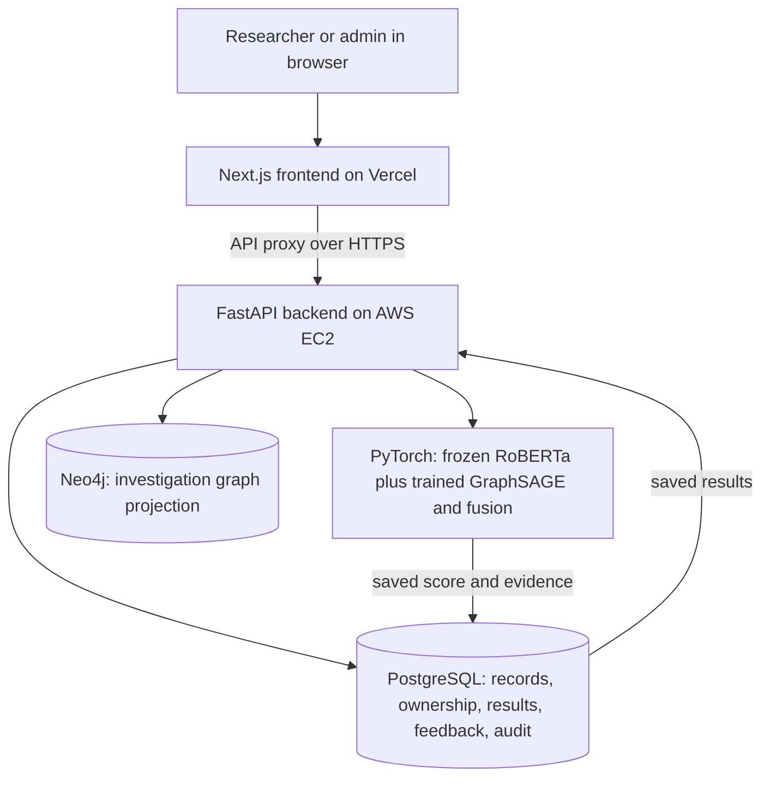

# NeuroGraph-DB: understand it before presenting it

Checked against this repository's saved training records and implementation on 31 October 2026. This guide describes the final deployed application. It replaces older defense notes that put synthetic examples first or described unmeasured performance.

## 1. Start with this answer: what have we built?

**Say:** “NeuroGraph-DB helps a person investigate suspicious online reviews. It looks at the review's words, some facts about the review, and its connections to earlier reviews. It produces a risk score, saves the result, and lets a human inspect the evidence.”

It is a research demonstration, not a machine that can prove somebody is lying. A genuine angry customer can write a one-star review. A fake review can sound polite and give five stars. This is why we combine several kinds of clues.

Three words to learn first:

- **Dataset:** a collection of examples, like a book of practice questions.
- **Model:** a program that learned patterns from examples instead of being given every decision as a hand-written rule.
- **Label:** the answer supplied with a training example, such as “spam” or “nonspam.” A prediction is the model's guess; it is not the supplied answer.

## 2. Exactly which dataset did we use?

Our final model uses the labelled `training_data.csv` in the Kaggle dataset [`samygithub/collective-opinion-spam-detection`](https://www.kaggle.com/datasets/samygithub/collective-opinion-spam-detection).

The exact local file is `.kaggle/yelpchi-raw/training_data.csv` under the repository root. It contains **47,176 historical Yelp reviews**, including:

- **6,243 Y labels:** the dataset's spam/filtered class, about 13.23%.
- **40,933 N labels:** the dataset's nonspam/recommended class.

Its columns are `id`, `Date`, `review ID`, `reviewer ID`, `product ID`, `rating_Helpful`, `rating_Thanks`, `rating_LoveThis`, `rating_OhNo`, `reviews`, and `Label`.

We use review text, date, review/reviewer/product identities, a numeric rating, and the training label. We do not feed every CSV column directly into the model. The builder explicitly treats the oddly named **`rating_OhNo` column as the rating field**; that mapping is recorded in the graph manifest. The labels map **Y → 1**, **N → 0**.

The original, broader YelpChi collection includes 67,395 reviews of Chicago hotels and restaurants. Our final labelled training source is the 47,176-row subset above. Do not mix these counts. The [dataset author's description](https://shebuti.com/yelpchi-dataset/) explains that the labels come from Yelp's recommended-versus-filtered distinction. They are useful research labels, not a court's finding that every filtered review is fake.

**Say:** “We used real historical YelpChi review data, specifically the 47,176 labelled rows in the Kaggle training CSV. Our labels follow the dataset's spam/nonspam convention, which is based on Yelp filtering and can contain errors.”

**Show:** original CSV; `output/viva/data/START_HERE_12_real_examples.csv`; `output/viva/evidence/dataset_and_split_proof.json`.

## 3. What are training, validation and test data?

Think of learning for an exam:

| Part | Simple meaning | Our exact rows |
|---|---|---:|
| Training | Practice questions with answers; used to learn model weights | 28,305 |
| Validation | A mock exam; used to choose the saved model and decision cutoff | 9,435 |
| Test | The final exam; used to report the result after those choices | 9,436 |

We sort the 47,176 labelled reviews by **date, then review ID**, and take roughly 60%, 20%, 20% in that order. Older reviews come first; later reviews become the test.

- Training: 23 October 2004 to 6 February 2011.
- Validation: 6 February 2011 to 15 November 2011.
- Test: 15 November 2011 to 8 October 2012.

Some boundary dates appear in two periods because multiple reviews share a date. Review-ID ordering breaks ties; the same review does not belong to two splits.

**Important filename trap:** the downloaded `testing_data.csv` contains **20,219 rows and no `Label` column**. It did not produce our reported supervised test metrics. We need known answers to measure correctness, so we held out 9,436 labelled rows from `training_data.csv` instead.

The local viva preparation script checks the source file's SHA-256 fingerprint against the saved graph manifest, reproduces the chronological ordering, checks all 47,176 labels against `evaluation_targets.npz`, and exports the exact saved split memberships. It does not randomly create a new split.

**Say:** “Training teaches, validation chooses, and testing measures. We kept the newest 9,436 labelled reviews for the final test. We did not use the unlabelled downloaded testing file to claim accuracy.”

**Show:** `output/viva/data/train_exact.csv`, `validation_exact.csv`, `test_exact.csv`; `ml/build_yelpchi_inductive_graph.py`.

## 4. Is the data real or synthetic?

**Synthetic** means deliberately made up by us for demonstration. It does not automatically mean useless; it means we must label its purpose honestly.

| Part | Origin | What we can claim |
|---|---|---|
| Historical YelpChi text, dates, identities and supplied labels | Real historical dataset | Used for training and labelled evaluation, with imperfect reference labels |
| Harbor Table / Cedar Spoon example investigation | Team-generated synthetic scenario | Demonstrates how connected reviews can be investigated; not final model performance |
| Website's downloadable example CSV | Demonstration input | Demonstrates uploading, scoring and reopening history; not proof of accuracy |
| A user's own CSV | Whatever that user supplied | New predictions; no measured accuracy without independent true labels |

Our final result page leads with the real model's evaluation. Synthetic scenarios have their own clearly marked example page. A realistic-looking restaurant name is not evidence that its reviews were collected from a real business.

**Say:** “Our final ML evaluation uses real historical reviews. We also provide clearly labelled synthetic examples to make the investigation workflow understandable.”

## 5. What does ‘NeuroGraph’ mean?

**Neuro** refers to neural networks: programs with adjustable numerical weights that learn patterns from examples.

- **RoBERTa** reads a review and converts its text into 768 numbers. These numbers describe patterns in the wording; they are not a 768-word summary. This number representation is called an **embedding**.
- **GraphSAGE**, a graph neural network, combines facts about a review and connected earlier reviews.
- A learned attention/fusion part joins the text and relationship information and produces a score.

**Graph** means a network of dots and links. A dot is a review. A link says that two reviews have a defined connection, such as the same author.

We reuse a pretrained, frozen RoBERTa. **Frozen** means we do not change its language-model weights during this training. We train the graph, projection, attention, fusion and classification parts. Do not say we trained a language model from scratch.

**Say:** “The neuro part is our neural model: RoBERTa handles language and GraphSAGE handles review connections. The graph part represents relationships between reviews. Neo4j stores a graph view; it is not itself the neural network.”

**Show:** `ml/models/roberta_relation_gnn.py`, especially `forward`; final `model_config.json`.

## 6. What information does the final model consider?

It uses **text + 14 numeric features + three relationship types**.

The 14 features are:

1. Rating.
2. Earlier review count for the same reviewer.
3. Earlier review count for the same product.
4. Character count.
5. Word count.
6. Fraction of uppercase characters.
7. Fraction of digits.
8. Fraction of punctuation.
9. Exclamation-mark count.
10. Question-mark count.
11–12. Two numbers representing the month.
13–14. Two numbers representing the day of the week.

Some counts use a logarithm: this shrinks huge numbers so they do not dominate everything else. Month/day use sine and cosine: these keep December near January and Sunday near Monday, like positions on a clock. Feature scaling puts numbers on a comparable scale; its averages and scales are learned from training rows only.

These are possible clues, not automatic guilt rules. Uppercase text, many exclamation marks, or one star does not by itself force a spam decision.

The connections are:

| Name | Connect two reviews when… | Why it may help |
|---|---|---|
| RUR | The reviewer is the same | Repeated behavior by the same account |
| RSR | The product **and rating** are the same | Similar rating behavior targeting the same business/product |
| RTR | The product is the same and the earlier review is within **30 days** | Concentrated activity around the same target |

The final model uses up to **50 recent earlier neighbors per relation**. It does not connect every one-star review on the entire internet. Neighbors need not themselves be spam. A connection is a reason to examine context, not proof of wrongdoing.

The graph branch aggregates neighbors' numeric features. The candidate review's text helps weight the three graph branches. Do not describe it as a search engine comparing every neighbor's entire text for plagiarism.

**Show:** `ml/build_yelpchi_inductive_graph.py`; `backend/app/services/inductive_relations.py`; `inductive_graph_manifest.json`.

## 7. On what basis is a review flagged?

The steps are:

1. Check and save a valid CSV row.
2. Read its text and build the 14 numeric features.
3. Find allowed earlier connected reviews.
4. Pass these inputs through the trained model.
5. Produce a score between 0 and 1.
6. Compare the score to the saved threshold.

Our final cutoff is **0.7870707071**, approximately **0.7871**.

- A score of **0.85** is flagged.
- A score of **0.40** is below the flagging threshold.
- These two scores are invented teaching examples, not measured outcomes for particular reviews.

“Cleared” means below our cutoff, not “proved genuine.” “Flagged” means worth investigation, not “proved fake.” A 0.90 score is not a demonstrated 90% probability of fraud; the output is not separately probability-calibrated.

The evidence can show score, cutoff, model/run identity, relation weights, neighbor identities and file/graph fingerprints. **Attention weights** say which relationship branch received more weight; they do not prove the real-world cause of fraud. A branch also contains the review's own features, so attention alone cannot prove that a real suspicious neighbor exists.

**Say:** “The model learns a combination of wording, behavior and relationships. We flag scores at or above the validation-selected cutoff. A human still needs to investigate.”

**Show:** `backend/app/services/inductive_yelpchi.py`, `score_batch`, especially `score >= self._threshold`.

## 8. How did we decide the threshold?

A threshold is like the pass mark on an exam, except this one separates scores that need investigation.

The code tries **199 cutoffs between 0.01 and 0.99** on the **validation** set. It chooses the cutoff with the highest **macro F1**, and saves the best validation model checkpoint. The test set does not choose this value.

- **Precision:** of the reviews we flagged, how many matched the spam labels?
- **Recall:** of the labelled spam reviews, how many did we catch?
- **F1:** a score balancing precision and recall.
- **Macro F1:** calculate F1 for each class, then give both classes equal weight.

Equal weight matters because only about 13% of our source rows carry the spam label. A program that always says “nonspam” could get roughly 87% ordinary accuracy on this class balance while catching no spam. That is why ordinary accuracy alone would be misleading.

A lower cutoff usually flags more reviews, catching more suspicious ones but troubling more genuine users. A higher cutoff usually flags fewer. Our chosen value reflects the validation-set objective; it is not a universal law or something the admin arbitrarily chose.

**Say:** “We chose 0.7871 using validation macro F1, so both classes matter. We then evaluated the locked choice on the test set.”

**Show:** `select_threshold` in `ml/train_yelpchi_multimodal.py`, imported by the final trainer; `metrics.json`.

## 9. Which training parameters did we use, and why?

**A parameter setting is a training control**, like the number of practice rounds or size of a notebook. Learned weights are different: the model adjusts those itself.

| Setting | Our value | Plain-English reason |
|---|---|---|
| Random seed | 42 | Start from a repeatable random setup; 42 is not a magic performance number |
| Text encoder | Frozen `FacebookAI/roberta-base` | Reuse language knowledge without the cost of retraining the language model |
| Text representation | 768 numbers per review | RoBERTa-base output size |
| Maximum text length | 192 tokens | Bound processing time and memory; long reviews are truncated; tokens are word pieces |
| Text encoding batch size | 64 during training preparation | Encode multiple reviews together efficiently; not the graph-training minibatch size |
| Numeric inputs | 14 | Combine writing style, rating, previous activity and time |
| Hidden size | 128 | Size of the model's internal representations; a practical capacity/memory tradeoff |
| Graph layers | One GraphSAGE layer for each of RUR, RSR, RTR | Learn the three relationship summaries separately |
| Neighbor cap | 50 per relation | Keep context bounded and reproducible |
| Dropout | 0.2 | Hide some internal values during training to discourage memorization |
| Optimizer | AdamW | Algorithm that adjusts the trainable weights to reduce mistakes |
| Learning rate | 0.001 | Size of weight-adjustment steps |
| Weight decay | 0.0001 | Discourage unnecessarily large weights |
| Training loss | Class-weighted cross entropy | Penalize wrong decisions while giving the smaller class enough importance |
| Maximum epochs | 80 | Up to 80 full training rounds; this saved run completed all 80 |
| Early stopping patience | 12 | Could stop after 12 rounds without improvement; it did not stop this run early |
| Selected checkpoint | Epoch 74 | Best validation result, rather than automatically the last round |

**Epoch:** one round of model training. **Loss:** a number measuring how wrong the model is; training tries to reduce it. The graph is trained as a full graph, using only training labels in its loss. The text batch size above does not mean 64 graph nodes per optimizer step.

The encoder revision is pinned to `e2da8e2f811d1448a5b465c236feacd80ffbac7b`, so a future download uses the same version. Text embeddings are calculated with padding ignored and averaged across the retained tokens.

Do not claim these settings were proved optimal through a large search. These are the implemented run settings; checkpoint and threshold were chosen on validation. The saved configuration records architecture settings; training defaults and the Kaggle launch document optimizer settings.

**Show:** `ml/train_yelpchi_inductive.py`; `ml/build_kaggle_inductive_kernel.py`; `model_config.json`; `training_log.json`.

## 10. What is our final result?

For the final **inductive** model, on **9,436 chronological held-out test reviews**:

| Metric | Result | Simple meaning |
|---|---:|---|
| ROC-AUC | **0.8105** | How well scores tend to rank labelled spam above labelled nonspam across cutoffs; 0.5 is chance ranking, 1 is perfect ranking |
| Macro F1 | **0.6624** | Balance of precision/recall with equal importance to both classes at our chosen cutoff |
| PR-AUC, implemented as average precision | **0.4211** | Summarizes the precision/recall tradeoff for the smaller spam class |
| Decision threshold | **0.7871** | Cutoff selected using validation data |

**Say:** “Our final model achieved a test ROC-AUC of 0.8105 and macro F1 of 0.6624 on 9,436 later reviews. It is useful as an investigation aid, but it still makes mistakes.”

Do **not** say “81.05% accuracy,” “66.24% of all reviews are correct,” “100% spam detection,” or “the uploaded CSV has 81% accuracy.” These statements do not follow from these metrics. The result is one recorded seed/run, not an average over repeated experiments or proof that we beat every existing model.

**Show:** `output/viva/evidence/metrics.json` or `docs/runs/raw_yelpchi_inductive_seed42_20261025T125837Z.json`.

## 11. What is the model comparison and why are there historical results?

A **benchmark** is an experiment with fixed data and known answers, so we can measure a model rather than judge it by how convincing the website looks.

| Verified experiment | What it uses | ROC-AUC | Macro F1 | What to say |
|---|---|---:|---:|---|
| Structured MAT GNN baseline | 45,954-node YelpChi matrix, 32 supplied numeric features, no raw-text encoder | 0.9331 | 0.8078 | Earlier structured known-node baseline |
| Raw multimodal benchmark | 47,176 reviews; RoBERTa plus graph information; random stratified split with a fixed known-node graph | 0.8439 | 0.6860 | Earlier model with known graph structure |
| **Final inductive model** | 47,176 reviews; chronological split and past-to-new-review context | **0.8105** | **0.6624** | The final model intended for newly uploaded reviews |

**Transductive / known-node** means the graph's review nodes already exist when the graph is prepared; only some answers are hidden. **Inductive** means the model is designed to handle arriving reviews it did not train on. Think “guess an answer for someone already in the class network” versus “assess a new arrival using earlier allowed information.”

These experiments have different representations and protocols. The largest number is not automatically the best model for new uploads. Do not call this a controlled proof that removing text improves performance, or claim the final model beats the baseline. A fair component comparison would keep data and evaluation conditions the same.

On the current site, **Model comparison** first evaluates four approaches on the same training, validation and test identities: text-only, graph-only, concatenation and NeuroGraph. These are a fairer architecture comparison because the test reviews and selection rules are shared. Select seed 42 to match the deployed checkpoint, or mean ± SD for seeds 42/43/44. Concatenation has the highest three-seed mean; NeuroGraph has the highest macro F1 for seed 42. We do not claim attention always improves performance.

The three historical experiments in the table above are all visible below the matched charts under **Earlier experiment records**. Their different data representations/protocols exclude them from a shared ranking. **Model results** still shows the deployed seed-42 checkpoint.

Evidence includes saved metrics, model configuration, training history, split identities, a **checkpoint** (saved learned weights), and **SHA-256 hashes** (digital fingerprints of files). A manifest lists expected fingerprints, so serving can reject modified or mismatched files. A fixed review is also rescored and compared within a small tolerance. This checks that the saved model runs consistently; it is not a replacement for testing thousands of labelled reviews.

**Show:** the three JSON records in `docs/runs/`; `fixed_review_reproduction.json`. The old synthetic near-perfect tables have been superseded; `ml/results_summary.md` now points to the measured controlled comparison.

## 12. What is ‘graph context scope’? Why is a snapshot disabled?

A **snapshot** is a saved, identified collection of review context. **Scope** means the boundary of what information this model is allowed to use.

For new uploads, the selected snapshot must be approved for batch context and compatible with **`inductive-rur-rsr-rtr-v1`**. The backend loads its training-partition historical context without selecting its ground-truth labels. It excludes history later than the earliest uploaded review. Earlier reviews within the same CSV can then become context for later rows.

The model receives earlier review facts and relationships, not the answers for those neighbors. The frozen snapshot itself is not overwritten by the upload. New CSVs also do not automatically retrain the model or add themselves to every future user's reference snapshot.

The older known-node snapshot is disabled because it belongs to a different model/evaluation setup. In the provided screenshots, #3 was compatible and #2 was not. IDs are database identifiers and can differ in another installation. Enabling an incompatible option would hide a real compatibility problem; the application should select the correct option and explain the disabled one.

**Say:** “Graph context scope controls which approved earlier reviews and relationship rules the model may use. It prevents us from accidentally mixing the wrong graph or using future information.”

**Show:** `backend/app/services/batch_graph.py`, `inductive_worker.py`, `inductive_yelpchi.py`, and `inductive_relations.py`.

## 13. Why Neo4j if PostgreSQL already stores the reviews?

We give them different jobs:

- **PostgreSQL:** structured records, ownership, saved scores, users, feedback and audit. Tables and keys keep the data consistent. It is the main source of truth.
- **Neo4j:** stores a relationship-oriented projection that can be read using **Cypher**, its graph query language. It helps display and explore which reviews are connected.
- **PyTorch + PyTorch Geometric:** actually perform the neural-network calculations. Neither database trains the model by itself.

For a completed uploaded analysis, the graph service rebuilds the same RUR/RSR/RTR arrival connections used for inference, checks the stored graph fingerprint, and writes review nodes and context links into Neo4j. The graph displayed to a user can therefore correspond to the saved analysis. Uploaded-analysis nodes are `UploadAnalysisReview`; `CONTEXT_FOR` links carry the relation type. Synthetic campaigns have a separate projection.

This does not mean the app copies every possible YelpChi edge into Neo4j for every user. It materializes the relevant investigation context. Scoring uses tensors in memory; Neo4j supports the graph investigation view.

**Say:** “PostgreSQL answers ‘what records and results do we have?’ Neo4j helps answer ‘how are these reviews connected?’ PyTorch calculates the model score.”

SQL could also represent links with joins. Neo4j is a design choice for graph queries and evidence, not a requirement for all ML or proof of a measured speed advantage. Do not quote the old notes' unsupported 7ms-versus-320ms comparison.

**Show:** `backend/app/services/batch_analysis_graph.py`; `backend/app/services/neo4j_synthetic_projection.py`; `backend/app/models.py`.

## 14. What is the human review feature?

A human can disagree with a model and leave a review note, including a proposed label. This is a second opinion, not another neural model.

The actual page is **Review feedback**:

1. A researcher creates feedback on a review they are permitted to access.
2. They can edit or delete their own note while it remains `submitted`.
3. An admin can triage it, resolve it, or reject it.
4. After moderation, it is locked against ordinary author edits.

**Triaged** means looked at and organized for attention; **resolved** means the moderation step has reached a decision. The database procedure performs the moderation update, and a trigger records feedback changes in the audit trail.

Feedback does **not** silently change the original prediction, replace the benchmark's supplied label, or retrain the model. That separation preserves the original machine result and the human's response.

**Say:** “The model suggests; a human investigates. We preserve both the original score and the human feedback so we can explain what happened.”

**Show:** `backend/app/api/feedback.py`; `backend/alembic/versions/0007_database_features.py`; `db-dashboard/frontend/app/feedback/page.tsx`.

## 15. What do researchers and admins get?

| Feature | Researcher | Admin |
|---|---|---|
| Read model results, benchmark and example pages | Yes | Yes |
| Upload and analyze CSVs | Yes | Yes |
| Reopen their own saved history | Yes | Yes |
| Select all-user upload history | No | Yes |
| Create feedback; edit/delete own submitted note | Yes | Yes |
| See all feedback and moderate it | No | Yes |
| Create/list application accounts and assign a role at creation | No | Yes |
| Change whether a graph snapshot is permitted as batch context | No | Yes |
| Administration menu: model registry, reviewer catalog, audit operations | Hidden | Shown |

The backend checks permissions for privileged operations; hiding a sidebar item alone is not security. One important nuance: the **reviewer catalog endpoint currently requires login but not the ADMIN role**, even though its sidebar item is under Administration. Do not claim every page in that menu is blocked at the API for researchers. Likewise, model information being placed under an admin menu does not mean every read-only model endpoint is admin-only.

The current user-management feature creates and lists accounts. Do not promise password reset, account deletion, or arbitrary role-edit tools that are not implemented.

**Show:** `backend/app/security.py`; `backend/app/api/routes.py`; `db-dashboard/frontend/app/components/AppShell.tsx`.

## 16. What are Products & history and Reviewer catalog?

**Products & history** now starts with saved CSV analyses. It lets a user find a filename, see the status, and reopen the stored scores and graph. Reopening is like reading a saved exam result: it does not need to take the exam again. File fingerprints and canonical batch/run records help recover an earlier receipt when the same file is retried.

Researchers see their own upload history. Admins can explicitly select all-user history. Product records still describe the businesses/items being reviewed; a CSV may contain more than one product.

**Reviewer catalog** means the authors of source reviews, with their source system, source reviewer key, internal ID and creation time. A Yelp review author is different from the researcher who logs into our website and uploads a CSV. The catalog is not a list of confirmed fraudsters, nor a model that scores every person. Its current API does not provide a complete author-risk profile or a banning feature.

**Show:** `db-dashboard/frontend/app/products/page.tsx`; `app/products/[batchId]/page.tsx`; `app/reviewers/page.tsx`; `backend/app/api/batches.py` and `/reviewers` in `routes.py`.

## 17. What are audit operations?

An **audit trail** is a diary of important system actions: who did something, what action happened, and when. It helps investigate mistakes and demonstrate accountability.

There are two things to distinguish:

- The **Audit operations page** currently displays operational checks: database/readiness information, graph-sync status and model status. It is a diagnostics page, not a complete searchable screen for every audit row.
- The PostgreSQL **`audit_logs` table** stores actual audit records. Application code records authentication-related events; the database trigger records feedback inserts, updates and deletes inside their transaction. Feedback audit data is redacted rather than copying sensitive comment text or secrets into logs.

The generic readiness check includes a separate legacy inference contract; it can report not-ready even when the verified benchmark/inductive runtimes work. For the active model, use its own status and a successful saved inference as evidence. Do not call all model runtimes healthy just because the website opens.

**Say:** “The audit table records important actions. The operations page helps an admin check service status. They are related, but the page is not a complete audit-log browser.”

**Show:** `backend/app/models.py` (`AuditLog`); `backend/alembic/versions/0007_database_features.py`; `db-dashboard/frontend/app/admin/audit/page.tsx`.

## 18. What is the system architecture and deployment?

**Architecture** means which part does which job and how the parts communicate.

- **Frontend:** the pages/buttons people see, built in Next.js/React/TypeScript, hosted on Vercel Hobby.
- **Backend/API:** FastAPI/Python, validates input, checks who may access it, coordinates scoring and returns results. An API is how the frontend asks the server to do work.
- **PostgreSQL 16:** main database. SQLAlchemy connects Python code to tables. Alembic records versioned schema changes.
- **Neo4j 5:** the graph database for the investigation projection.
- **Model:** trained using Kaggle's GPU environment; deployed inference runs on the AWS server's CPU. Showing a score does not retrain the model.
- **Docker Compose:** starts the backend and databases in separate containers on one EC2 server. A container is a packaged runtime for a service.
- **Caddy:** provides HTTPS for the backend. HTTPS encrypts traffic between client and server.
- **AWS CloudFormation:** the infrastructure definition, so server setup is described in files. SSM is used for remote terminal management.
- **Private S3 artifacts:** large model/deployment bundles are transferred privately instead of committing them to GitHub.
- **GitHub Actions CI:** tests the code and build. CI is not proof that every Git push automatically deploys the AWS backend; the backend update is handled by terminal deployment scripts.

The frontend calls a same-origin proxy, which forwards requests to the backend. Database passwords and signing secrets stay on the server, not in browser code. Argon2 stores password hashes; short-lived access tokens and refresh cookies manage login sessions.

Live frontend: https://frontend-three-snowy-10.vercel.app

Backend host: https://neurograph-16-171-237-56.sslip.io

The recorded AWS setup uses one `m7i-flex.large` server (8 GB memory), an encrypted 50 GB disk, and web ports 80/443. Database and SSH ports are not public. PostgreSQL is self-hosted on this VM, not a separate managed RDS service. Render is not the current backend host. The older `db-dashboard/backend` Express/Prisma prototype is not the deployed FastAPI API.

AWS hosting is on a finite, credit-funded **Free account plan**. It is not unlimited free hosting forever. The project scripts check the Free-plan state and remaining credit before authorized AWS changes and do not upgrade to Paid. This guide does not provision or change any service.

**Show:** `deploy/aws/stack.json`, `compose.yaml`, `Caddyfile`, `start.sh`; `backend/app/main.py`; frontend `next.config.js`; `.github/workflows/ci.yml`.

## 19. What is the novelty of our project?

**Novelty** means what is useful and distinctive about our work. It does not have to mean inventing an entirely new branch of mathematics.

Our defensible contribution is putting these parts together in a working, inspectable course project:

1. Review text and three kinds of relationship evidence contribute to a learned score.
2. A chronological new-arrival setup reduces the shortcut of using future review context.
3. Relational records and a Neo4j graph view support both saved results and investigation.
4. Users have private saved CSV histories instead of scores that disappear when a page closes.
5. Each prediction can be tied to a model run, input context and reproducible evidence.
6. Human feedback and audit records preserve both the machine output and later moderation.
7. Real benchmark results are separated from synthetic examples.

**Say:** “Our main contribution is an integrated, database-backed investigation workflow: text-plus-graph scoring, time-aware context, saved per-user results, and traceable human review.”

RoBERTa, GraphSAGE, RUR/RSR/RTR relations and YelpChi research already existed. We should not claim we invented them, reached state-of-the-art performance, or demonstrated detection of modern AI-generated reviews. The historical dataset alone does not establish the last claim.

## 20. Useful database answers for this particular course

- **Table:** one kind of record, such as users or reviews.
- **Primary key:** a unique identifier for a row.
- **Foreign key:** an identifier linking a row to an existing row in another table. It prevents impossible links.
- **Normalization:** separating independent facts so we do not copy the same user's details into every review. Our authoritative app schema has 23 domain tables; the ERD/dictionary explain the relationships and the deliberately saved result/evidence snapshots.
- **Transaction:** related database changes succeed together or roll back together. We should not leave half a prediction record or half a moderated feedback update.
- **View:** a saved SQL query presented like a table. We have `vw_batch_analysis_summary` and `vw_product_review_summary`.
- **Stored procedure:** a named operation executed inside PostgreSQL. `resolve_review_feedback` controls feedback moderation.
- **Trigger:** a database action that runs automatically after specified changes. `trg_review_feedback_audit` records feedback changes.
- **ORM:** SQLAlchemy lets Python work with database records; it still uses the real relational database and its constraints.
- **Backup/restore:** `pg_dump -Fc` and `pg_restore`; the repository has evidence of an isolated restore drill, not merely an exported text file.

**Show:** `docs/submission/ERD.md`, `DATA_DICTIONARY.md`, `NORMALIZATION.md`; `backend/app/models.py`; migration `0007_database_features.py`; `docs/submission/evidence/backup-restore.json`.

## 21. A two-minute explanation to practise

“Our project is NeuroGraph-DB, a system for investigating suspicious online reviews. A review can look normal by itself but become suspicious when we examine its writing and relationships to earlier reviews.

“We used 47,176 labelled historical YelpChi reviews. We sorted them by time: 28,305 for training, 9,435 for validation, and 9,436 for the final test. The labels follow the source dataset's Yelp filtering convention, so they are useful but imperfect.

“RoBERTa converts the words into numbers. GraphSAGE studies review connections: the same reviewer, the same product and rating, or the same product within 30 days. A trained fusion layer combines the clues and gives a risk score. We reused frozen RoBERTa and trained the graph and classification parts.

“Our final test ROC-AUC is 0.8105 and macro F1 is 0.6624. We selected the 0.7871 flagging cutoff using validation data. These are benchmark results, not a guarantee that every user upload is correctly classified.

“PostgreSQL stores users, uploads, predictions and feedback. Neo4j supports the relationship investigation view. Users can reopen their own previous results, and admins can manage accounts and moderate feedback. Human feedback does not erase the original model prediction.

“The frontend is on Vercel; the FastAPI backend, PostgreSQL and Neo4j run in Docker on AWS. Our contribution is bringing scoring, saved private history, graph evidence and human review together in one traceable system. Synthetic examples are clearly separated from real benchmark evaluation.”

## 22. What to open in class, in order

Start with **`output/viva/OPEN_FIRST.md`**. It has clickable local file links; all paths below are relative to the repository root.

| Order | Open | Explain |
|---:|---|---|
| 1 | Live app → Model results | Final result, threshold and limits |
| 2 | `output/viva/data/START_HERE_12_real_examples.csv` | Real review text, author/product IDs and supplied labels; illustrative sample only |
| 3 | `output/viva/evidence/dataset_and_split_proof.json` | Exact source fingerprint, source count and verified split counts |
| 4 | `output/viva/data/test_exact.csv` | Actual held-out test rows, not the unlabelled downloaded testing file |
| 5 | `output/viva/evidence/metrics.json` | Actual recorded test results |
| 6 | `output/viva/evidence/model_config.json` | Frozen text encoder, 14 features, dimensions and chronological split |
| 7 | `ml/models/roberta_relation_gnn.py` | Text branch, graph branches, learned attention, fusion and classifier |
| 8 | App → Upload & analyze → Products & history | Fresh CSV scoring and reopening stored results |
| 9 | `backend/app/services/batch_analysis_graph.py` | Same relationship evidence projected into Neo4j |
| 10 | App → Review feedback; migration `0007_database_features.py` | Human review, procedure, trigger and audit |
| 11 | `docs/submission/ERD.md` | Relational design, keys and relationships |
| 12 | `deploy/aws/compose.yaml`, `stack.json` | Actual cloud deployment architecture |

The original dataset and large model bundles are local/private files; they are not included in a fresh public GitHub clone. Keep passwords, environment files and cloud credentials off the projector. Do not upload the labelled historic test files as “new” CSV demonstrations: their IDs can already exist in the database. Use the app's fresh-upload example instead.

## 23. Ten answers that prevent common viva mistakes

1. **“Is every one-star review fake?”** No. Stars are one clue; the model combines text and relationships.
2. **“Does a flag prove fraud?”** No. It requests investigation and can be wrong.
3. **“Is RoBERTa your invention?”** No. We reuse it frozen and train our graph/fusion/classification layers.
4. **“Is Neo4j doing the neural calculation?”** No. PyTorch/PyG does; Neo4j stores the investigation projection.
5. **“Why is the higher 0.9331 model not your final upload model?”** It uses a different structured known-node setup. Its result does not establish performance on new raw CSV arrivals.
6. **“What if the CSV has no correct answers?”** We can give scores, but cannot measure its accuracy.
7. **“Will feedback immediately improve the model?”** No. It records human judgments; retraining would need a separate controlled process.
8. **“What if a reviewer/product is completely new?”** The inductive path can encode new text and metadata against an approved historical snapshot; relationship evidence may be sparse. Novel IDs do not guarantee informative neighbors, and performance outside the Yelp domain is unverified.
9. **“What if model evidence is missing?”** The verified path rejects unavailable/mismatched model artifacts rather than inventing a score. Missing Neo4j can prevent the graph view even if scoring is available.
10. **“What should be improved next?”** Test more seeds and newer labelled data, compare components under the same split, calibrate scores, study transfer to other domains, and improve the diagnostics/audit UI. Those are future improvements, not already achieved results.

## 24. Why does concatenation sometimes score higher than NeuroGraph

Our new controlled comparison uses the same real training and test reviews for four architectures. Concatenation has the highest average across seeds 42/43/44. NeuroGraph has the highest macro F1 for the deployed seed-42 run. This means the experiment supports combining text and graph information, but does not establish that attention/gating always improves classification.

Say: “We measured rather than assumed the benefit. Both combined models beat the single-modality arms here. Concatenation has the strongest mean, while our deployed checkpoint leads seed-42 macro F1. Our project also contributes saved results, graph inspection and auditable human feedback; we do not claim a universal state-of-the-art detector.”

A fair test can produce a result that does not support an initial hypothesis. Report it and identify the next controlled experiments; do not replace the measured numbers with the old synthetic near-perfect scores.
