# Complete relational entity relationship diagram

Generated from `backend/app/models.py`. Every application table is included. Alembic owns physical migrations.

```mermaid
erDiagram
    USERS o|--o{ AUDIT_LOGS : actor_user_id
    AUDIT_LOGS {
        bigint audit_log_id PK
        bigint actor_user_id FK
        varchar action
        varchar entity_type
        varchar entity_key
        jsonb before_data
        jsonb after_data
        uuid request_id
        timestamp_with_time_zone created_at
    }
    USERS o|--o{ BATCH_ANALYSES : requested_by_user_id
    GRAPH_SNAPSHOTS o|--o{ BATCH_ANALYSES : historic_graph_snapshot_id
    INFERENCE_RUNS o|--o{ BATCH_ANALYSES : inference_run_id
    BATCH_ANALYSES {
        bigint batch_analysis_id PK
        uuid batch_key
        bigint requested_by_user_id FK
        varchar source_system
        varchar source_filename
        bigint historic_graph_snapshot_id FK
        bigint inference_run_id FK
        varchar upload_sha256
        integer row_count
        integer accepted_count
        integer rejected_count
        varchar status
        jsonb blocking_reasons
        timestamp_with_time_zone created_at
    }
    BATCH_ANALYSES ||--o{ BATCH_ANALYSIS_ROWS : batch_analysis_id
    REVIEWS o|--o{ BATCH_ANALYSIS_ROWS : review_id
    BATCH_ANALYSIS_ROWS {
        bigint batch_analysis_row_id PK
        bigint batch_analysis_id FK
        integer row_number
        varchar uploaded_review_key
        varchar row_state
        bigint review_id FK
        jsonb validation_errors
        timestamp_with_time_zone created_at
    }
    INFERENCE_RUNS ||--o{ FRAUD_PREDICTIONS : inference_run_id
    REVIEWS ||--o{ FRAUD_PREDICTIONS : review_id
    FRAUD_PREDICTIONS {
        bigint fraud_prediction_id PK
        bigint inference_run_id FK
        bigint review_id FK
        numeric risk_score
        smallint predicted_label
        jsonb attention_weights
        varchar graph_status
        timestamp_with_time_zone created_at
    }
    GRAPH_SNAPSHOTS ||--o{ GRAPH_SNAPSHOT_REVIEWS : graph_snapshot_id
    REVIEWS ||--o{ GRAPH_SNAPSHOT_REVIEWS : review_id
    GRAPH_SNAPSHOT_REVIEWS {
        bigint graph_snapshot_id PK
        bigint review_id PK
        varchar split
    }
    GRAPH_SNAPSHOTS {
        bigint graph_snapshot_id PK
        varchar snapshot_key
        varchar dataset_name
        varchar dataset_sha256
        text artifact_uri
        varchar artifact_sha256
        varchar graph_builder_version
        varchar relation_schema_version
        varchar split_protocol_key
        bigint node_count
        jsonb edge_counts
        timestamp_with_time_zone created_at
        varchar storage_status
        boolean batch_context_permitted
        varchar context_scope_key
        varchar provenance
    }
    REVIEWS o|--o{ GRAPH_SYNC_JOBS : review_id
    GRAPH_SNAPSHOTS o|--o{ GRAPH_SYNC_JOBS : graph_snapshot_id
    USERS o|--o{ GRAPH_SYNC_JOBS : requested_by_user_id
    GRAPH_SYNC_JOBS {
        bigint graph_sync_job_id PK
        varchar operation
        bigint review_id FK
        bigint graph_snapshot_id FK
        bigint requested_by_user_id FK
        varchar source_event_key
        varchar idempotency_key
        varchar status
        integer attempt_count
        integer max_attempts
        timestamp_with_time_zone next_attempt_at
        timestamp_with_time_zone created_at
        timestamp_with_time_zone started_at
        timestamp_with_time_zone completed_at
        varchar last_error_code
        text last_error
        timestamp_with_time_zone updated_at
    }
    INFERENCE_RUNS ||--o{ INDUCTIVE_INFERENCE_JOBS : inference_run_id
    INFERENCE_RUNS ||--o{ INDUCTIVE_INFERENCE_JOBS : provenance
    INDUCTIVE_INFERENCE_JOBS {
        bigint job_id PK
        bigint inference_run_id FK
        varchar status
        varchar worker_id
        varchar lease_token
        timestamp_with_time_zone lease_expires_at
        integer attempt_count
        integer max_attempts
        integer priority
        timestamp_with_time_zone next_attempt_at
        timestamp_with_time_zone started_at
        timestamp_with_time_zone completed_at
        varchar last_error_code
        text last_error
        varchar provenance FK
        timestamp_with_time_zone created_at
        timestamp_with_time_zone updated_at
    }
    FRAUD_PREDICTIONS ||--o{ INDUCTIVE_PREDICTION_EVIDENCE : fraud_prediction_id
    GRAPH_SNAPSHOTS ||--o{ INDUCTIVE_PREDICTION_EVIDENCE : graph_snapshot_id
    INDUCTIVE_PREDICTION_EVIDENCE {
        bigint evidence_id PK
        bigint fraud_prediction_id FK
        bigint graph_snapshot_id FK
        varchar relation_schema_version
        timestamp_with_time_zone context_cutoff_at
        jsonb neighbor_counts
        jsonb historic_review_ids
        varchar stitched_graph_sha256
        varchar input_feature_sha256
        varchar embedding_sha256
        varchar bundle_manifest_sha256
        varchar provenance
        timestamp_with_time_zone created_at
    }
    MODEL_VERSIONS ||--o{ INFERENCE_RUNS : model_version_id
    MODEL_VERSIONS ||--o{ INFERENCE_RUNS : model_version_id
    MODEL_VERSIONS ||--o{ INFERENCE_RUNS : provenance
    GRAPH_SNAPSHOTS ||--o{ INFERENCE_RUNS : graph_snapshot_id
    USERS o|--o{ INFERENCE_RUNS : requested_by_user_id
    INFERENCE_RUNS {
        bigint inference_run_id PK
        uuid run_key
        bigint model_version_id FK
        varchar provenance FK
        bigint graph_snapshot_id FK
        bigint requested_by_user_id FK
        varchar idempotency_key
        numeric threshold
        varchar status
        integer requested_count
        integer completed_count
        timestamp_with_time_zone created_at
        timestamp_with_time_zone completed_at
    }
    PREPROCESSING_VERSIONS ||--o{ MODEL_VERSIONS : preprocessing_version_id
    MODEL_VERSIONS {
        bigint model_version_id PK
        varchar version_key
        varchar model_name
        varchar architecture_version
        jsonb architecture_config
        varchar config_sha256
        text checkpoint_uri
        varchar checkpoint_sha256
        bigint preprocessing_version_id FK
        varchar input_contract_version
        varchar supported_inference_mode
        numeric recommended_threshold
        text threshold_source
        varchar lifecycle_status
        varchar provenance
        timestamp_with_time_zone verification_at
        timestamp_with_time_zone created_at
    }
    PREPROCESSING_VERSIONS {
        bigint preprocessing_version_id PK
        varchar version_key
        varchar preprocessing_sha256
        jsonb preprocessing_config
        varchar code_revision
        varchar lifecycle_status
        timestamp_with_time_zone created_at
        timestamp_with_time_zone verified_at
    }
    PRODUCTS {
        bigint product_id PK
        varchar source_system
        varchar external_product_key
        varchar display_name
        timestamp_with_time_zone created_at
    }
    REVIEWS ||--o{ REVIEW_FEEDBACK : review_id
    USERS o|--o{ REVIEW_FEEDBACK : submitted_by_user_id
    REVIEW_FEEDBACK {
        bigint feedback_id PK
        bigint review_id FK
        bigint submitted_by_user_id FK
        varchar feedback_type
        smallint ground_truth_label
        text comment
        varchar idempotency_key
        varchar status
        timestamp_with_time_zone created_at
    }
    REVIEWS ||--o{ REVIEW_VARIANTS : review_id
    REVIEW_VARIANTS {
        bigint review_variant_id PK
        bigint review_id FK
        varchar variant_key
        varchar variant_type
        text variant_text
        jsonb review_metadata
        timestamp_with_time_zone created_at
    }
    REVIEWERS {
        bigint reviewer_id PK
        varchar source_system
        varchar external_reviewer_key
        timestamp_with_time_zone created_at
    }
    REVIEWERS o|--o{ REVIEWS : reviewer_id
    PRODUCTS o|--o{ REVIEWS : product_id
    USERS o|--o{ REVIEWS : submitted_by_user_id
    REVIEWS {
        bigint review_id PK
        varchar source_system
        varchar source_review_key
        bigint reviewer_id FK
        bigint product_id FK
        bigint submitted_by_user_id FK
        smallint rating
        timestamp_with_time_zone reviewed_at
        text review_text
        smallint ground_truth_label
        varchar label_source
        timestamp_with_time_zone created_at
        timestamp_with_time_zone updated_at
    }
    ROLES {
        bigint role_id PK
        varchar role_key
        varchar display_name
        text description
        timestamp_with_time_zone created_at
    }
    USERS ||--o{ SESSION_TOKENS : user_id
    SESSION_TOKENS o|--o{ SESSION_TOKENS : replaced_by_session_id
    SESSION_TOKENS {
        uuid session_token_id PK
        bigint user_id FK
        varchar access_jti_hash
        varchar refresh_token_hash
        timestamp_with_time_zone created_at
        timestamp_with_time_zone last_used_at
        timestamp_with_time_zone access_expires_at
        timestamp_with_time_zone refresh_expires_at
        timestamp_with_time_zone revoked_at
        uuid replaced_by_session_id FK
    }
    SYNTHETIC_CAMPAIGNS ||--o{ SYNTHETIC_CAMPAIGN_MEMBERS : synthetic_campaign_id
    REVIEWERS ||--o{ SYNTHETIC_CAMPAIGN_MEMBERS : reviewer_id
    SYNTHETIC_CAMPAIGN_MEMBERS {
        bigint synthetic_campaign_member_id PK
        bigint synthetic_campaign_id FK
        bigint reviewer_id FK
        varchar membership_type
        varchar provenance
    }
    SYNTHETIC_CAMPAIGNS ||--o{ SYNTHETIC_CAMPAIGN_REVIEWS : synthetic_campaign_id
    REVIEWS ||--o{ SYNTHETIC_CAMPAIGN_REVIEWS : review_id
    SYNTHETIC_CAMPAIGN_REVIEWS {
        bigint synthetic_campaign_review_id PK
        bigint synthetic_campaign_id FK
        bigint review_id FK
        varchar campaign_period
        text evidence_note
        varchar provenance
    }
    PRODUCTS ||--o{ SYNTHETIC_CAMPAIGNS : product_id
    SYNTHETIC_CAMPAIGNS o|--o{ SYNTHETIC_CAMPAIGNS : prior_campaign_id
    SYNTHETIC_CAMPAIGNS {
        bigint synthetic_campaign_id PK
        varchar campaign_key
        varchar campaign_name
        bigint product_id FK
        bigint prior_campaign_id FK
        timestamp_with_time_zone prior_start_at
        timestamp_with_time_zone prior_end_at
        timestamp_with_time_zone attack_start_at
        timestamp_with_time_zone attack_end_at
        text description
        varchar provenance
        timestamp_with_time_zone created_at
    }
    ROLES ||--o{ USERS : role_id
    USERS {
        bigint user_id PK
        bigint role_id FK
        varchar email
        varchar email_normalized
        varchar username
        varchar password_hash
        boolean is_active
        timestamp_with_time_zone created_at
        timestamp_with_time_zone updated_at
        timestamp_with_time_zone last_login_at
    }
```

A table with a composite primary key uses the full key shown. Optional actors use SET NULL; provenance references use RESTRICT. A child-to-parent relationship expresses one parent per row; it does not imply that the parent must have a child.
