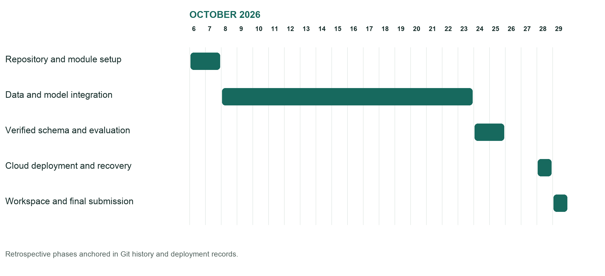
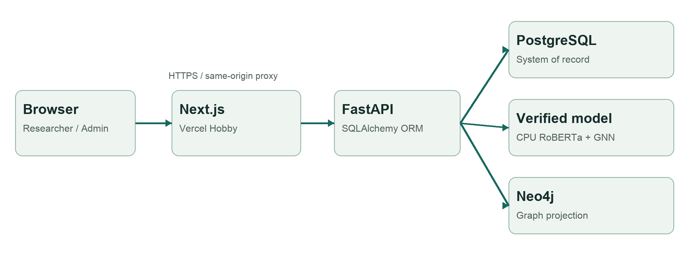
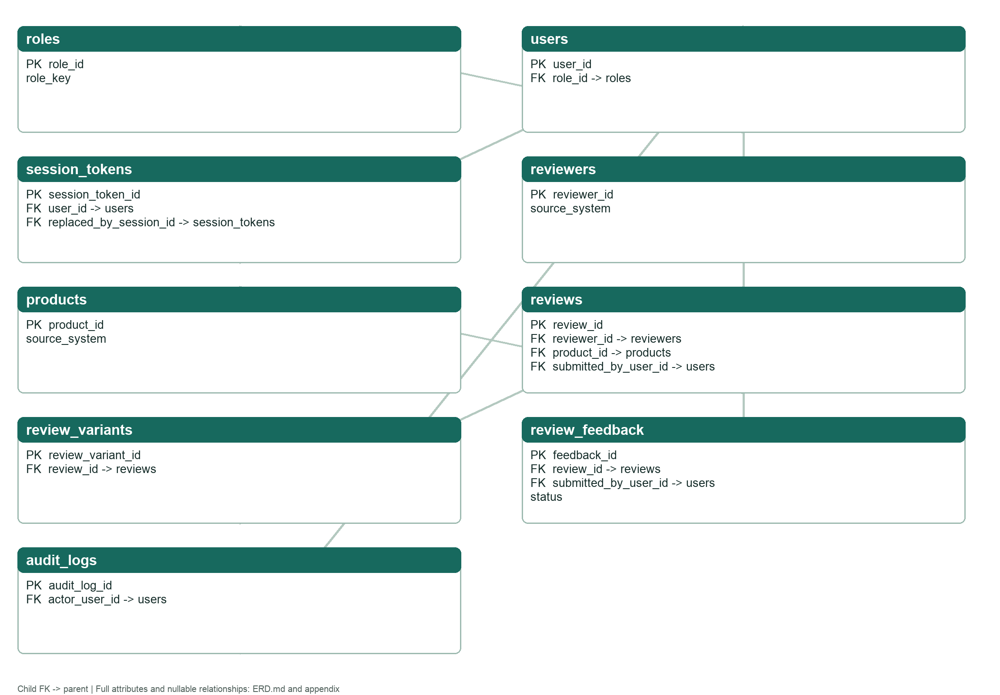
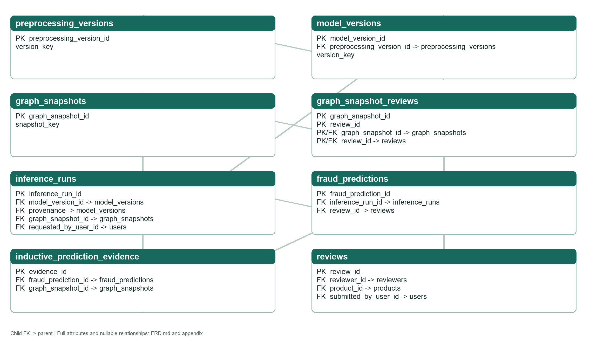
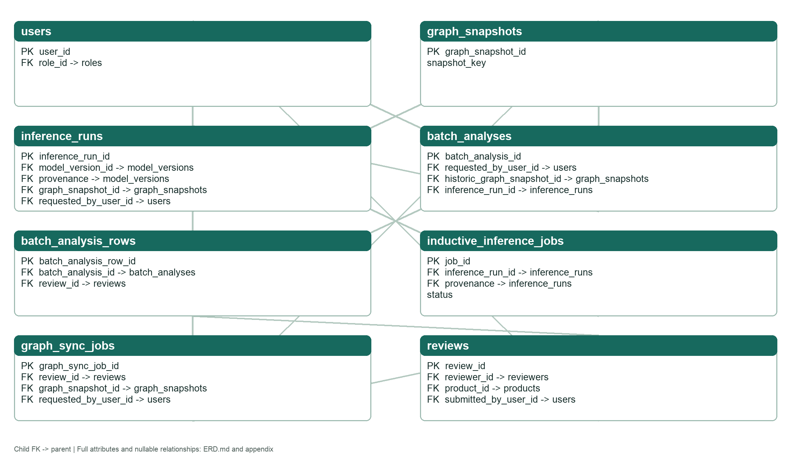
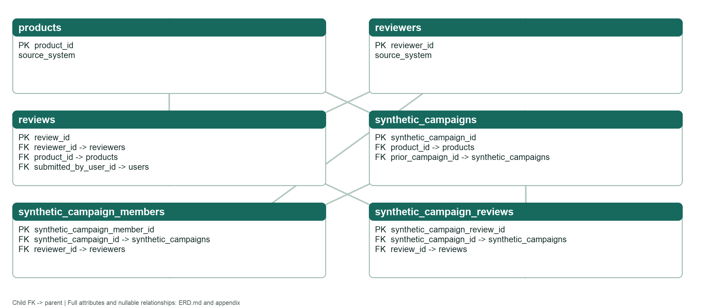
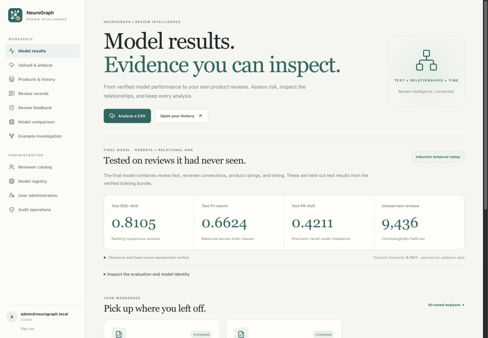
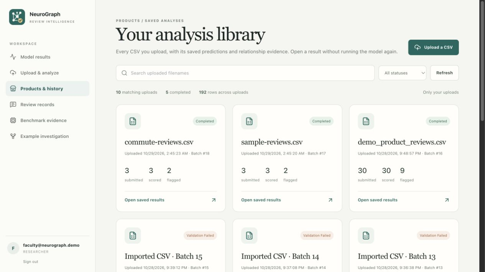
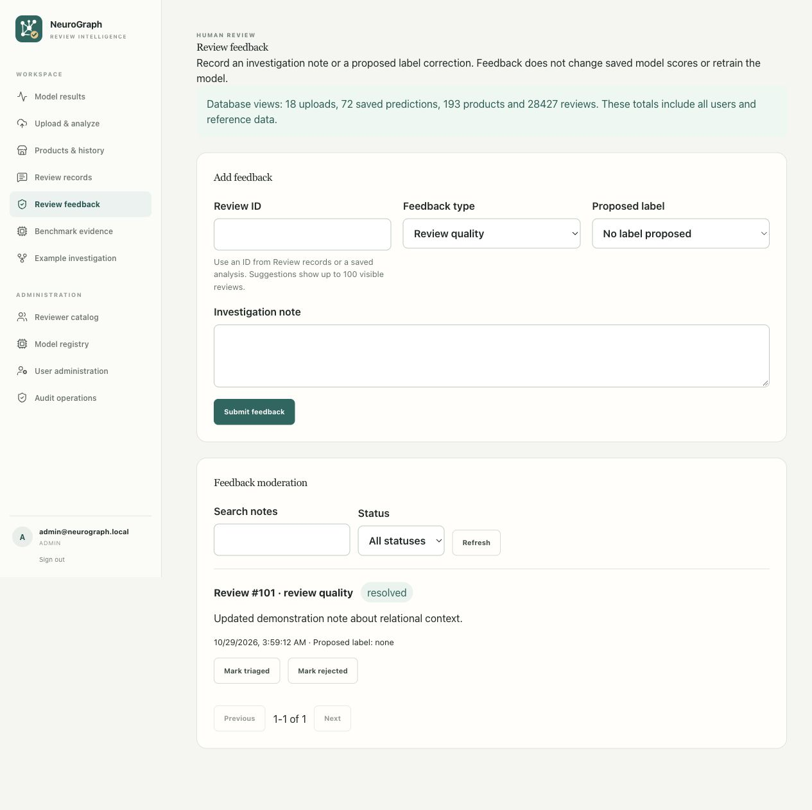
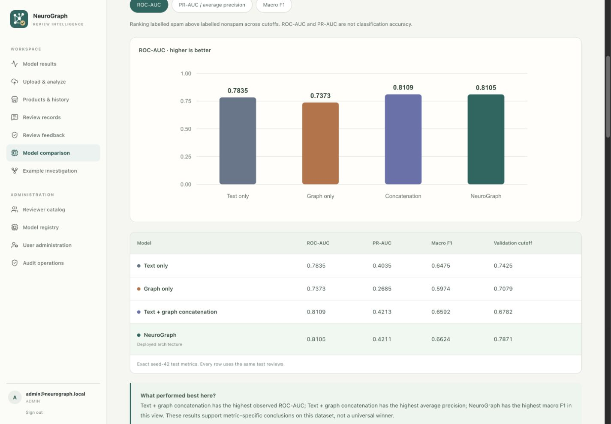

# NeuroGraph Database Systems Project

## 1 Project overview

NeuroGraph-DB is a review investigation application that stores review identities, user uploads, graph context, model versions, predictions and investigation feedback in a relational system of record. A reviewer can submit an unlabelled CSV, inspect risk scores and relationship evidence, and return later to the same calculated result. The application supports a course-faculty research account and an administrator account with different menus, pages, data scopes and API permissions.

The final deployed model is a temporal inductive RoBERTa and relational graph model. Its verified chronological test ROC-AUC is 0.8105, F1 macro is 0.6624 and PR-AUC is 0.4211 on 9,436 unseen test reviews. The model's output is an investigation signal. It does not prove that a review is fraudulent and it does not establish accuracy on an unlabelled user upload.

A controlled four-model comparison now holds the real-data identities and chronological split fixed. Across seeds 42/43/44, simple concatenation has the highest mean metrics; the deployed NeuroGraph checkpoint has the highest macro F1 for seed 42. The project does not claim that text-conditioned attention consistently beats concatenation.

The database contribution is the durable, secure workflow around those model results: normalized source identities, foreign-key integrity, versioned evidence, transactional CSV intake, requester-specific result history, audited human feedback and native recovery. PostgreSQL is the authoritative database; Neo4j is a relationship projection. A clearly labelled synthetic case study supports demonstration without being presented as the model's measured performance.

## 2 Problem statement and objectives

Online reviews influence product and restaurant decisions. Text alone cannot show related authors, targeted products, repeated timing, score provenance or later investigation changes. Spreadsheet workflows make upload history, access control and recovery difficult to manage.

The project addresses this organizational data problem with a relational application that can store, retrieve, secure and analyze review evidence. Its objectives are to preserve canonical review identity; enforce database integrity; score compatible new reviews with a verified model; retain each user's upload and result history; provide graph evidence for investigation; and support human feedback with controlled administrator resolution.

Evaluation requires reproducible verified models, separate inductive and known-node protocols, working database features and reviewable deployment/recovery evidence.

### Scope and users

The researcher role uploads UTF-8 CSV review batches, revisits its own saved analyses, reads visible reference reviews, and creates or edits its own submitted feedback. The administrator additionally manages application users and model registrations, inspects all-user history explicitly, and resolves feedback. External review authors are stored as reviewers; they are not a second class of login account.

The system does not process payments, publish accusations, autonomously retrain models or provide a fraud adjudication service. Raw datasets and large verified bundles are distributed separately from the source repository. A fresh clone can run database, API and UI tests, but real ML inference requires those exact verified artifacts.

### Deliverables

| Deliverable | Evidence |
|---|---|
| Relational design and implementation | Complete 23-table ERD, schema SQL, field dictionary, constraints and indexes |
| Working application | Next.js dashboard, FastAPI API, CSV scoring, private history and feedback CRUD |
| Secure access | One users table, role FK, Argon2, JWT, refresh rotation, logout and server-side authorization |
| Advanced database features | Two aggregate views, PostgreSQL stored procedure, feedback audit trigger and transaction tests |
| Recovery and engineering | Native backup and isolated restore evidence, Docker build, GitHub Actions and meaningful history |
| Course submission | This report, source snapshot, evidence files and faculty demonstration guide |

## 3 Project planning and responsibilities

The team responsibilities follow the repository's module ownership: Avaneesh Chavan handles ingestion, data preparation and application/database integration; Eldo John Giby handles model design, training, evaluation and verified bundles; Anubhav Bhattacharya handles visualization, documentation and evidence presentation. Final integration and defense preparation are shared responsibilities. The cover records the team-confirmed registration numbers, course code, class number, slot and faculty.

The project history begins on 6 October 2026 with repository and module work. Subsequent records cover integration, verified evaluations and deployment. The following Gantt summarizes those documented phases; it is a retrospective schedule, not a claim that every phase occupied each full calendar day.

| Period | Work and milestone |
|---|---|
| 6 to 7 October | Repository setup, module ownership, data pipeline and model/visualization groundwork |
| 8 to 23 October | Review preparation, research model integration and investigation interfaces |
| 24 to 25 October | Schema/API verification, real YelpChi evaluation bundles and model contracts |
| 28 October | Cloud deployment, authenticated access and upload recovery |
| 29 October | Model-first workspace, personal history, feedback database features and final submission evidence |

## 4 Technology and system architecture

| Layer | Implementation and purpose |
|---|---|
| Browser application | Next.js 15.5, React 18 and TypeScript; responsive researcher and administrator workspace |
| Backend | Python 3.11 FastAPI; validation, structured errors, role checks and orchestration |
| ORM and migrations | SQLAlchemy 2 application queries; Alembic schema and advanced database objects |
| Primary database | PostgreSQL 16; authoritative relational identities, execution records and audit |
| Graph database | Neo4j 5; rebuildable relationship evidence and Cypher queries |
| ML | CPU PyTorch and PyTorch Geometric; frozen pinned RoBERTa encoder and relation-aware model |
| Hosting | Vercel Hobby frontend; one AWS server with Docker Compose and Caddy HTTPS |
| Engineering | GitHub main/dev branches, automated CI, native recovery script and reproducible evidence exports |

The frontend calls relative API paths. Next.js proxies them to the backend so refresh cookies remain on the application origin. FastAPI validates the request and authenticates the session before using a SQLAlchemy session. CSV intake commits its receipt, row outcomes and accepted review resolutions transactionally. Verified scoring pins the model, threshold and compatible historical graph, and persists predictions and evidence hashes.

The current API lives in backend/. The Express/Prisma prototype is archived and not deployed. Alembic and SQLAlchemy metadata define the submission schema.

## 5 Database design

The final application contains 23 domain tables and 37 foreign-key columns. Every base table has a primary key. The Alembic version table is migration bookkeeping and is not counted toward the minimum table requirement. Four central entities are Users, Reviews, Reviewers and Products; Roles, Model Versions and Graph Snapshots provide additional independent entities. The model includes substantially more than the minimum three relationships.

The complete ER diagram source is generated directly from the current metadata in docs/submission/ERD.md. It includes every application table and all mapped attributes. The following plates show the same domain entities with their primary/foreign keys and selected state fields at a readable scale. Repeated context entities link the plates; arrows point from the foreign-key child to its referenced parent. Each child refers to at most one parent per FK; a parent can have many children. Nullable FKs indicate optional links. Full field nullability and composite constraints appear in the appendix and executable schema.

### Relational mapping and integrity

A user has one role through users.role_id; both ADMIN and RESEARCHER accounts are rows in that same users table. Session tokens reference users and store token digests, expiry and revocation state. Products and reviewers use source-scoped external identifiers so independent datasets do not collide.

Reviews reference the product, review author and optional submitting application user. The source-system and review-key pair is either both absent or both present. A partial unique index prevents duplicate source review keys. Rating is bounded to 1 through 5; labels, where available from reference data, are 0 or 1. A user upload does not need a ground-truth label.

Graph snapshot membership is a junction relation with a composite primary key. A model points to one preprocessing version. An inference run pins a model, graph context, requester and threshold. Each saved prediction is unique within its run and review. Batch rows connect upload receipts to canonical review records without transferring ownership of another user's result history.

Deletion policies preserve evidence: core provenance references use RESTRICT, dependent records such as session tokens use CASCADE where appropriate, and optional historical actor references use SET NULL. The migration DDL and appendix list the exact rules. The feedback audit trigger does not store credentials, raw review text or free-text comments.

## 6 Normalization and index rationale

The source identity and association design follows 1NF, 2NF and 3NF principles. Values are stored in typed columns, repeated relationships use junction tables, composite-key attributes depend on the whole association, and names or descriptions are not copied onto each review or prediction. For example, Reviews retains reviewer_id and product_id while source identity and product display name stay in Reviewers and Products. Roles are decomposed from users, and preprocessing configuration is decomposed from model versions.

An inference threshold is a historical run parameter, rather than an implied current model property; it can differ from a model recommendation. Batch import counts describe that specific validation event. Audit before/after objects record historical events, not current duplicate identity rows. Configuration JSON represents a versioned artifact contract; it does not replace relational keys and relationships.

The physical execution schema deliberately repeats some provenance classifications in model, run and job records for composite-FK enforcement. Those classifications can be derived from linked versions, so strict 3NF for every operational stored attribute is not claimed. The normalized logical projection joins through model identity and omits duplicated classification values. The tested serving contracts retain that explicit integrity redundancy; docs/submission/NORMALIZATION.md explains the tradeoff and its evaluation boundary. This is a disclosed design exception, not a hidden assertion of full physical normalization.

Indexes support observed access patterns: review product/time and author/time queries; source-key uniqueness; requester-specific upload history; prediction run/review lookup; due-work job lookup; and feedback owner/status/time filtering. A real EXPLAIN ANALYZE was saved for a product review query. Its plan uses an index access path; the evidence records one local measurement and is not presented as a universal latency guarantee or a fabricated before/after speedup.

## 7 Database implementation

Alembic revisions 0001 through 0007 create and evolve the current schema. The complete PostgreSQL SQL export is included as schema-postgresql.sql. Database creation uses PostgreSQL's native database facilities; migrations then create the application objects. SQLAlchemy is used for ordinary application CRUD, filtering, grouping and joins. Raw SQL is limited to migration DDL, PostgreSQL CALL, native diagnostics and recovery checks where the database feature requires it.

### CRUD and transactional workflow

The feedback workflow gives a visible, safe CRUD demonstration. An authenticated researcher creates feedback for a visible review, reads and searches its own notes, updates a still-submitted note and removes a still-submitted note. Other researchers cannot access that private feedback by guessing its ID. The original review and predictions remain unchanged. Once triaged or resolved, the requester cannot edit or delete the note.

CSV intake creates a durable batch record and one outcome per parsed row. Compatible identical canonical reviews may be reused while each requester receives an independent upload receipt. Changed content under an existing source review ID is rejected. An identical file retry for the same requester recovers the saved receipt and existing result instead of recalculating it. Database exceptions roll back the transaction and return a structured error; partial in-memory changes are not silently committed.

### Joins aggregates and views

The application joins batch rows to reviews, products and authors for investigations, and predictions to inference runs, models, preprocessing and snapshots for provenance. Aggregate queries derive scored/flagged counts for saved history. The administrator feedback page reads two actual migration-owned views through SQLAlchemy Core.

| Database view | Definition and use |
|---|---|
| vw_batch_analysis_summary | LEFT JOIN from upload receipts to their inference-run predictions; COUNT, SUM of flagged decisions and AVG risk grouped per batch |
| vw_product_review_summary | LEFT JOIN from products to reviews; COUNT reviews and AVG rating grouped per product, including products without reviews |

At the 29 October 2026 verification, the production administrator summary contained 18 upload receipts, 72 saved predictions, 193 products and 28,427 reviews. These include all users and reference data. They are not metrics for one uploaded file and are not the final model's test sample size.

### Stored procedure and trigger

Migration 0007 installs resolve_review_feedback(feedback_id, actor_id, status). It validates the requested status, checks that the actor is an active administrator, updates the selected feedback row and raises an exception if the row is missing. Public procedure execution is revoked; the application owner invokes it through the authorized API. It changes feedback state only, not model predictions or training labels.

The row-level PostgreSQL trigger trg_review_feedback_audit executes after INSERT, UPDATE or DELETE on review_feedback. The trigger writes an audit row in the same transaction. It records allowlisted IDs, type, status and proposed label, taking the application actor from a transaction-local setting. It omits the comment and all authentication secrets. A rollback of procedure resolution also rolls back the trigger's audit record; this was tested on PostgreSQL.

### Database evidence that was executed

The PostgreSQL-only tests create a new empty disposable database, run the complete migration chain, inspect primary keys and views, reject invalid rating and missing-product FK values, exercise trigger insert/update/delete, reject researcher procedure resolution and invalid statuses, and verify that rolling back a procedure call restores both feedback and audit state. The tests refuse to run against a database that already contains the users table.

## 8 Application workflows and user experience

The homepage leads with verified final model results. Saved personal analyses follow, and reference benchmarks and synthetic case studies are supporting links. This prevents a visitor from confusing an illustrative restaurant campaign with measured ML output.

Products and history is an upload/result library rather than an unlabeled raw catalog. A requester can search by filename, filter status, page through its uploads and open a permanent result URL. Administrators default to their own history and explicitly select all-user scope when needed. Original filenames that were never recorded are not invented; old receipts retain a batch identifier until truthful metadata is recovered.

The upload form selects a compatible historical context. The older known-node multimodal snapshot is intentionally ineligible for new CSV inference because its relation/input contract differs from the final inductive model. Removing the disabled dropdown option improves clarity without weakening that safety boundary. The form validates required columns, UTF-8 format, CSV extension and the backend's 8 MiB and 5,000-row bounds. Backend validation remains authoritative.

Saved results lead with a plain-English summary: scored, flagged, not flagged, accepted-but-unscored and rejected rows are distinct. Search, decision filters, score/CSV-row sorting and pagination make larger uploads inspectable. Opening a review shows its full text, saved cutoff, actual context counts and relation attention; feedback preselects the internal review ID and links back to the batch. The CSV export includes every saved row outcome and escapes spreadsheet formulas. “Not flagged” does not certify authenticity; risk scores are not calibrated fraud probabilities or measured upload accuracy.

The graph initially shows all relation types and counts only links drawn between visible nodes. The model registry is read-only provenance and current inductive-runtime status, with historical checkpoints and scoring jobs separated from benchmark comparisons. The administrator reviewer catalog maps source author identities and opens correctly filtered review records; it provides no account-level fraud classification. Native review dialogs support keyboard focus and Escape.

### Controlled model comparison

For ordinary user files, the live relational context is earlier rows within that upload: user-specific author/product identities do not join to the Yelp reference identities. The approved snapshot gates compatibility and eligibility but does not supply unrelated business history. Small-batch cold-context accuracy has not been separately measured, and uploads predating eligible reference history may fail. Source namespaces are assigned server-side per authenticated uploader; identical filenames and external IDs cannot collide across new users' imports. Existing saved receipts remain accessible.

The Model comparison page at /benchmarks addresses the earlier lack of a like-for-like architecture comparison. All four arms share the exact 47,176 raw review identities, chronological train/validation/test membership, source label mapping and validation-selection objective. The test has 9,436 reviews, including 1,251 spam and 8,185 nonspam labels. Text-enabled arms share the frozen RoBERTa vectors; graph-enabled arms share the same 14 features and causal RUR/RSR/RTR edges. Input modalities and trainable parameter counts intentionally differ as architecture ablations.

For seed 42, the NeuroGraph arm reuses the sealed deployed checkpoint and reproduces its recorded metrics within 1e-6. The other arms are trained under the fixed plan. Seeds 43 and 44 provide additional training initializations without changing dataset membership. All use hidden width 128, dropout 0.2, AdamW learning rate 0.001, weight decay 0.0001, class-weighted cross entropy, a maximum of 80 epochs and patience 12. The selected epoch and one of 199 cutoffs are chosen by validation macro F1 before test metrics are calculated.

This is a fixed-budget, not confirmed-convergence comparison. Each full-batch epoch is one gradient update; all nine text-enabled runs reached 80 epochs, while graph-only stopped after 38–54. Some validation curves were still improving, so differences can reflect convergence speed. No longer-budget experiment or model replacement is claimed.

| Seed 42 architecture | ROC-AUC | Average precision | Macro F1 |
|---|---:|---:|---:|
| Text only | 0.7835 | 0.4035 | 0.6475 |
| Graph only | 0.7373 | 0.2685 | 0.5974 |
| Text + graph concatenation | 0.8109 | 0.4213 | 0.6592 |
| NeuroGraph | 0.8105 | 0.4211 | 0.6624 |

NeuroGraph has the highest macro F1 for seed 42. Concatenation has slightly higher seed-42 ROC-AUC and average precision. These metric-specific observations are not a universal superiority claim.

At the deployed cutoff, the test confusion counts are TP 553, FP 834, TN 7,351 and FN 698. Flag precision is 39.9% and recall 44.2%; ROC-AUC must not be mistaken for precision or accuracy. A low-spam-prevalence file can have a larger proportion of false-positive flags, and domain transfer is unmeasured. The UI states this beside the flag summary and suppresses relation-gate percentages for relations with no eligible neighbors. Gate weights are across three relation types, not individual-neighbor attention or causal proof.

| Architecture across 3 seeds | ROC-AUC mean and SD | AP mean and SD | Macro F1 mean and SD |
|---|---:|---:|---:|
| Text only | 0.7821 ± 0.0015 | 0.4011 ± 0.0024 | 0.6499 ± 0.0022 |
| Graph only | 0.7389 ± 0.0016 | 0.2687 ± 0.0020 | 0.5983 ± 0.0020 |
| Text + graph concatenation | 0.8110 ± 0.0034 | 0.4222 ± 0.0099 | 0.6628 ± 0.0034 |
| NeuroGraph | 0.8084 ± 0.0033 | 0.4154 ± 0.0162 | 0.6589 ± 0.0033 |

Concatenation has the highest three-seed mean. Both combined arms outperform the single-modality arms in these recorded runs. The attention/gate does not demonstrate a consistent metric improvement over simple concatenation. SD is sample standard deviation across training seeds, not a confidence interval; a small mean difference is not presented as established statistical superiority. No production checkpoint was replaced by selecting the highest test score.

The site provides selectable seeds/mean, zero-to-one metric bars, ROC and precision-recall curves, recorded cutoffs and download links. It additionally tests missing-context sensitivity by independently removing links with probability 10%, 30% or 50%, using a fixed label-independent seed and frozen weights/cutoffs. This is not an LLM camouflage or real coordinated-attack robustness claim.

The earlier 45,954-node structured MAT run (0.9331 ROC-AUC), random-split raw known-node run (0.8439) and deployed temporal checkpoint (0.8105) remain visible as historical records below the matched charts. They are excluded from the new ranking because their representations or evaluation rules differ. The 5,000-node near-perfect prototype tables were synthetic, with label-conditioned features and links, and are superseded as real-data performance evidence.

The comparison is retrospective on the existing holdout rather than a new independent blind dataset. Source timestamps have day-level resolution, so review-ID ordering within a day is a replay convention rather than verified real arrival time. The modality comparison does not isolate graph links from the numeric features added alongside them. The original deployed checkpoint was GPU-trained; added runs train on CPU using the same optimization settings, with recorded environments. Temporal replay permits earlier unlabelled arrivals as context, whereas a live snapshot/upload can supply different history. These limitations and the imperfect Yelp reference labels are documented beside the results. The report JSON, per-run logs, validation selections and artifact fingerprints are committed; raw reviews, checkpoints and prediction arrays remain private/local dependencies.

## 9 Authentication authorization and security

Passwords are hashed with Argon2. JWT access tokens have bounded expiry; refresh credentials are opaque, stored as digests on the server and delivered in Secure HttpOnly SameSite cookies. Refresh tokens rotate, sessions can be revoked, and logout invalidates the relevant session. The client shares a single refresh operation across parallel failed requests, retries once and clears stale user/role state if the session is invalid. Ten regression tests cover expiry, concurrency, logout races and CSV FormData retries.

ADMIN and RESEARCHER share one users table, distinguished by a foreign key into roles. Menus and protected routes reflect the authenticated role, but server authorization is decisive: a researcher receives 403 for administrator resolution and aggregate administration, and private resources are scoped or return 404. Cached role labels do not grant API access. The deployed checks exercised those denials as well as allowed administrator operations.

ORM expressions and bound parameters prevent user text from becoming executable SQL. Feedback search escapes wildcard characters, and tests submit an SQL-injection-style search value without exposing unrelated records. Validation errors use structured responses, and internal errors carry a request ID without displaying passwords or a raw server trace to users.

Secrets are supplied through ignored environment/private files. Hardcoded demo-login autofill and the legacy JWT fallback were removed from current source. Production credentials were already rotated before this release. CORS now uses explicit configured origins rather than the temporary defense wildcard. Database ports are not publicly exposed; HTTPS terminates at Caddy and management uses SSM.

The deployment currently uses the database owner account inside its isolated application network. Separate least-privilege migration/application DB roles, more comprehensive rate limiting and stricter browser token storage are future production-hardening work; the project does not claim these controls are already implemented. Native dumps are private because a database backup contains account hashes and review data even when no plaintext password appears in the file.

## 10 Backup recovery and operational evidence

The recovery utility uses pg_dump in PostgreSQL custom format and restores through pg_restore with --single-transaction and --exit-on-error. It creates a new disposable database rather than restoring over the running source, compares all public table counts, checks model/prediction provenance joins and verifies that source counts remained unchanged. It removes only the disposable restore database after verification.

The executed local drill used schema revision 0007_database_features, produced a 10,239,431-byte native dump, matched all 24 public-table counts including Alembic bookkeeping, and recovered 30 predictions joined to inference run, model version, preprocessing version and graph snapshot. The SHA-256 and per-table counts are included in evidence/backup-restore.json. This local snapshot contains 28,415 reviews; it is intentionally distinguished from the later production aggregate, which contains additional uploaded reviews.

The cloud patch also retained a native database export and the previous backend image before applying its additive migration. Verified bundles and graph artifacts require separate checksum-preserving storage; a database dump is not a replacement for those model files. Neo4j is a rebuildable projection rather than the authoritative source of saved predictions.

## 11 Testing and deployment

| Check | Executed result |
|---|---|
| Backend suite with disposable PostgreSQL | 31 October critical-fix verification: 93 passed, 0 failed, 0 skipped |
| Clean checkout without private bundles | 31 October verification: 81 passed; 12 explicit bundle-dependent skips; PostgreSQL tests included |
| Frontend authentication, CSV import and result interpretation | 31 October verification: 29 passed, 0 failed; includes empty-relation gates, import mapping, missing-score handling, saved decisions and formula-safe export |
| Matched benchmark scientific contracts | 6 passed; thresholds, sparse gradients, shared labels, metric reproduction and publication identity checked |
| Responsive comparison interface | Desktop and phone views, seed selection and metric switching verified |
| Production frontend build | Compiled successfully with type and lint checks |
| Native backup and restore | Equal table counts, preserved source and 30 joined prediction-provenance records |
| Live application feedback workflow | Create/read/update/delete, admin resolution, locked resolved notes, validation and role denial passed |
| Cloud update | Additive 0007 migration applied; backend container healthy; Vercel production READY |

The frontend production URL is https://frontend-three-snowy-10.vercel.app. The HTTPS backend is https://neurograph-16-171-237-56.sslip.io. The public source is https://github.com/Eldo-John-Giby/NeuroGraph-DB and the private submission mirror is https://github.com/Avaneeshchavan/neurograph-db-submission. Instructor login details are distributed separately and privately.

The AWS deployment uses an active Free account plan and refuses scripted mutations unless the expected account, FREE/ACTIVE status, expiry and credit reserve pass a preflight. It runs one server with PostgreSQL, Neo4j, the CPU backend and HTTPS containers. The plan consumes finite credits and is time-limited; no indefinite zero-cost hosting guarantee is made and no paid upgrade is performed. Vercel remains on Hobby.

## 12 Version control and bonus evidence

The repositories preserve progressive history exceeding ten meaningful commits and provide main and dev branches. The public team repository remains updated. A private submission mirror exists under Avaneesh Chavan's account; the approved existing teammates have been invited with push permission and must accept those invitations. Secrets, dumps, local submission identities, large private bundles and rendered intermediates are excluded from commits.

The corrected GitHub Actions workflow tests the actual FastAPI service rather than the archived Express prototype. The verified successful run is https://github.com/Eldo-John-Giby/NeuroGraph-DB/actions/runs/41174270640 for source commit c9a8eb8. Its backend, frontend and container jobs all completed successfully. Later local submission-critical changes have separate local test evidence and are not covered by that hosted run until released and checked by CI. The workflow runs API/model-contract tests, real PostgreSQL migrations, Next.js lint/build, authentication tests and a deployable Docker build. Standard Linux runners execute on the public source repository; hosted jobs skip the private mirror to avoid consuming metered allowances. No workflow embeds cloud credentials or launches an unguarded paid deployment.

The implemented CI pipeline automatically tests and builds code; production release remains an explicit CLI step, not automatic CD. It supports the +1 pipeline bonus as evidence for faculty evaluation. Automated regression tests, trigger-based audit logging, verified recovery and measured query-plan evidence support the additional industry-practice +1 category. These practices are not counted as several separate bonus marks.

The default Vercel and sslip.io addresses are provider hostnames, not a claimed custom-domain bonus. No separately owned or registered custom domain is configured. Docker images are built and deployed, but Docker Hub publication is not claimed because no Docker Hub login is configured. No paid domain or registry subscription was purchased to pursue marks.

## 13 Faculty demonstration and submission contents

The suggested demonstration starts with final model results and the shared-test comparison, then uploads the sample CSV, reopens its saved history and graph, demonstrates feedback CRUD as a researcher, and resolves another note as administrator. The database portion shows the complete ERD, current migration, views, trigger, procedure, actual PostgreSQL tests and native restore evidence. The repository portion shows progressive history, main/dev, private collaboration and the CI run.

The ZIP includes the PDF report and editable Word report, README and rubric mapping, complete schema/ERD/dictionary sources, screenshots, executed evidence JSON, a credential-free source snapshot and a short submission guide. Large model bundles, production database dumps and infrastructure secrets are excluded. The live demo supplies inference; the reproduction runbooks identify the exact separate artifacts required for offline scoring.

The faculty handout specifies the live URL and engineering requirements, but does not identify a submission portal, email recipient, report template or mandatory filename. The package is prepared for course submission. It has not been sent to the faculty or uploaded to an unspecified course portal.

## 14 Limitations and future development

The controlled benchmark does not show a consistent gain from attention over concatenation. The three-seed results describe initialization variation on a reused split; they are not independent domain validation or evidence against all existing fraud detectors.

The project is an academic investigation aid with evidence-backed predictions, not a production fraud decision system. The chronological evaluation has nonzero error and moderate PR-AUC; calibration, drift monitoring and independent domain validation would be needed before operational decisions. Attention is descriptive model evidence and is not a causal proof.

The physical execution schema's explicit provenance redundancy remains a normalization qualification. Private mirror invitations await teammate acceptance. Docker Hub publication and an independently configured custom domain are not evidenced. Least-privilege database roles and stronger public-service abuse controls are future hardening work. The generic graph maintenance queue is retained in source but is not advertised as a complete autonomous worker service.

The implemented system still provides the principal course demonstrations: relational design, ORM-backed application development, CRUD, joins, aggregation, views, transactions, procedure, trigger, constraints, indexes, secure role-based access, native recovery, progressive Git history, Docker and a live cloud application. The accompanying coverage matrix identifies evidence and qualifications so the submission can be evaluated without unsupported claims.

## References

Database Systems Lab QP 8, School of Computer Science and Engineering, Vellore Institute of Technology, Fall Semester 2026-2027, supplied course handout, nine pages. The cover uses the team's confirmed lab course code BCSE302P.

PostgreSQL documentation: SQL CREATE PROCEDURE, CREATE TRIGGER, pg_dump and pg_restore. https://www.postgresql.org/docs/16/

SQLAlchemy ORM and transaction documentation. https://docs.sqlalchemy.org/en/20/orm/

GitHub Actions workflow and billing documentation. https://docs.github.com/en/actions and https://docs.github.com/en/billing/concepts/product-billing/github-actions

Vercel domain configuration documentation. https://vercel.com/docs/domains/working-with-domains/add-a-domain

NeuroGraph verified run records and reproduction instructions, included in docs/runs and the inductive/multimodal runbooks. Results from different protocols are reported separately.

Hamilton, W. L., Ying, R. and Leskovec, J. Inductive Representation Learning on Large Graphs. NeurIPS 2017. https://arxiv.org/abs/1706.02216

Liu, Y. and colleagues. RoBERTa A Robustly Optimized BERT Pretraining Approach. 2019. https://arxiv.org/abs/1907.11692

Rayana, S. and Akoglu, L. Collective Opinion Spam Detection Bridging Review Networks and Metadata. KDD 2015. Dataset description and filtering-label limitations: https://shebuti.com/yelpchi-dataset/

Controlled comparison protocol, training logs and results: docs/benchmarks/README.md, protocol.json, comparison.json and results.csv. Average precision is calculated with scikit-learn: https://scikit-learn.org/stable/modules/generated/sklearn.metrics.average_precision_score.html
